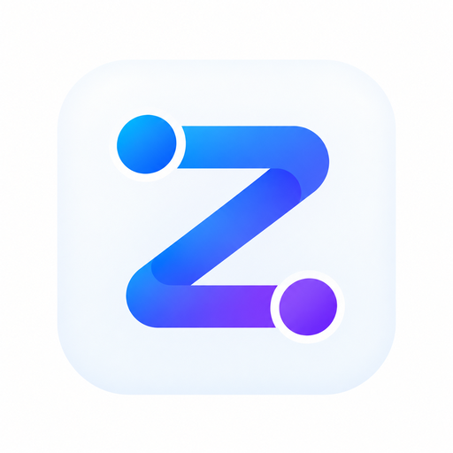
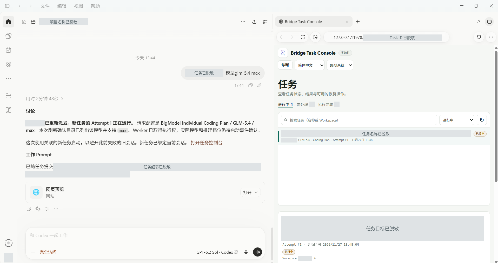
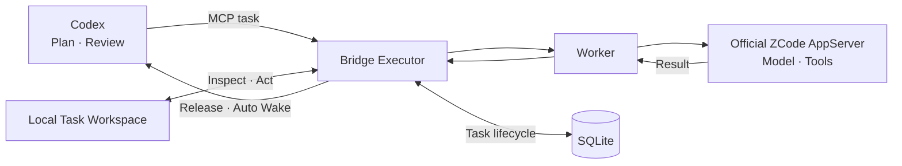

<p align="center">
  
</p>
<h1 align="center">Codex ZCode Bridge</h1>
<p align="center"><strong>Codex plans and reviews. ZCode executes. Bridge keeps the workflow moving.</strong></p>
<p align="center">
  
</p>
<p align="center"><sub>Redacted screenshot of a real Bridge Task Console while a task was running. The interface still shows the <em>Experimental</em> badge; the project name, task ID, task name, prompt, task goal and workspace path are redacted.</sub></p>
<p align="center">
  <a href="README.zh-CN.md">简体中文</a> · <a href="https://github.com/Sandyzzx/codex-zcode-bridge/releases">Releases</a> · <a href="docs/WEB_CONSOLE.md">Task Workspace</a> · <a href="docs/ZCODE_RUNTIME.md">Troubleshooting</a>
</p>

Codex ZCode Bridge is a local, asynchronous agent orchestration plugin. Delegate a development task to the official ZCode runtime, let it work while Codex is free to do other things, and return to the original Codex conversation for review when execution finishes.

## Why Bridge?

- **Delegate outcomes, not just commands.** Codex defines the goal, scope and acceptance checks; ZCode implements and tests the task through its own AppServer.
- **Work asynchronously.** A separate Executor owns accepted work. The Codex conversation need not keep polling while ZCode executes.
- **Keep task history.** SQLite records attempts, progress, results and cleanup; reconnect and inspect work rather than starting over blindly.
- **Return to the original conversation.** Auto Wake requests a new turn after release, allowing Codex to read the result, independently review changes and request rework when necessary.
- **Use the models available to your runtime.** Discover current models from the official AppServer, select a plan and reasoning level, or set a default. Bridge does not maintain a model whitelist.

## Quick start

**Requirements:** Windows x64; Node.js 24.16.0 (verified); Git; Codex with plugin support; a separately installed, signed-in official ZCode Desktop with authorized model access.

### Install

Install the Stable 2.0.0 release:

```sh
codex plugin marketplace add https://github.com/Sandyzzx/codex-zcode-bridge.git --ref codex-zcode-bridge-v2.0.0
codex plugin add codex-zcode-bridge@codex-zcode-bridge
```

This pins the installation to a published release. Enable only one installation of Bridge at a time.

Start a new Codex conversation, review the plugin's `SessionStart` hook, and ask Codex to run `zcode_doctor` if setup needs diagnosis. Marketplace installation does not require cloning the source or running `npm install`.

## Your first task

Open a project in Codex and ask:

> Use ZCode Bridge with Coding Plan to fix the failing parser test. Only edit the parser and its tests. Run the focused tests, then independently review the diff and test results. Do not commit or push.

You can explicitly name a model and reasoning level, for example `GLM-5.4 / low` when your runtime offers it. Bridge delegates only when you request it or have already explicitly authorized delegation for the goal.

## How it works



Bridge coordinates execution rather than proxying model API requests. Codex remains responsible for independent acceptance; a Worker reporting `completed` is not an acceptance decision.

## Task Workspace

Open the local console link in a task receipt to inspect task status, attempt history, results, observed token usage and failure reasons. The console provides supported task actions, search, English/Chinese and light/dark themes. Runtime checks and cost evidence live under Diagnostics. Opening the page does not send model requests.

The console uses the same Executor and SQLite authority; it is not a second task system. If cleanup cannot be verified, an explicit user-authorized release is available for eligible abnormal tasks. This releases Bridge occupancy only, not necessarily a live process; a Worker might still write to the workspace.

## Models and plans

| Plan | Support in 2.x |
| --- | --- |
| Individual Coding Plan | Authorized execution through the installed official AppServer. Real GLM-5.4 / low execution verified on Windows before Stable release. |
| Start Plan | Technical adaptation retained, including the `-StartPlan` selection alias. Current real-account availability is unverified; official access restrictions apply. |

Bridge discovers models from the official runtime using its current local provider configuration. It does not grant plan entitlements, bypass provider restrictions or guarantee promotional discounts.

Explicit plan/model choices take priority. When a model is available in both plans and you specify only the model, Start Plan is preferred; when only one offers it, that plan is selected. An unavailable or rejected selection is reported, not silently replaced with a different model or plan.

## What has been verified?

The Stable runtime baseline (Preview.20) passed the Windows and Ubuntu release test matrix and a real Windows Coding Plan task using GLM-5.4 / low, including file creation, Result, Cleanup, Release and Auto Wake. GLM-5.4 / max model selection and readback also passed without a model turn. The Stable packaging candidate adds release identity and documentation only and does not repeat real model execution. Earlier real Host tests demonstrated completion Wake and acceptance-driven rework.

Historical verified ZCode Desktop installations: 3.18.2.10443, 3.19.0.10774 and 4.0.0.10870, with different verification scopes. Other safe installations may be attempted without a static version whitelist; compatibility is not guaranteed. See [runtime notes](docs/ZCODE_RUNTIME.md).

Real end-to-end Continue against the Stable 2.0.0 release, current Start Plan entitlement and execution, fully exited Desktop recovery, not-loaded Host Wake and Windows reboot recovery are not established by the latest release evidence. CI on Ubuntu does not establish real production support on Linux or macOS.

## Safety and updates

- **Trusted local use only.** ZCode operates with your OS user permissions. Task path constraints and Git worktrees are not security sandboxes. Do not include credentials in task prompts.
- **Auto Wake is enabled by installing and enabling the 2.x plugin.** It may consume Codex usage. Turn it off in Task Workspace Diagnostics. Queue acknowledgement does not guarantee a new turn starts in every Host state.
- **Upgrade carefully.** Stop or finish active work before upgrading. The 2.x runtime supports SQLite v14 only; older schemas are rejected without destructive conversion. Back up task data and follow the [runtime and upgrade guide](docs/ZCODE_RUNTIME.md). Do not assume rollback to an older plugin can read newer Result fields.
- **Billing is controlled by providers.** No guaranteed multiplier, free usage or savings. Missing provider settlement is displayed as not observed.

## Documentation

[Architecture](docs/ARCHITECTURE.md) · [Task Workspace](docs/WEB_CONSOLE.md) · [Runtime and upgrades](docs/ZCODE_RUNTIME.md) · [MCP interfaces](docs/INTERFACES.md) · [Security](plugins/codex-zcode-bridge/SECURITY.md) · [Developer documentation](docs/README.md)

## License

Apache-2.0. See [LICENSE](LICENSE) and [NOTICE](NOTICE). This project is an independent integration, not an official Codex or ZCode product.

## A note from the author

This project began as a way to make Codex and ZCode work together more efficiently. I am glad to have brought that idea to life.

However, GLM-5.4's performance in my own development work fell short of my expectations. In my experience, ZCode's former 0.67 billing multiplier is no longer available and Start Plan allocations have become less frequent. I no longer find ZCode compelling enough for my workflow and have stopped using it.

The project remains open source, but I will no longer maintain it on a regular basis. Please do not expect timely fixes, compatibility updates, or responses to issues. If you find the project useful, you are welcome to fork it and continue its development.

Thank you to everyone who has used or supported this project.
