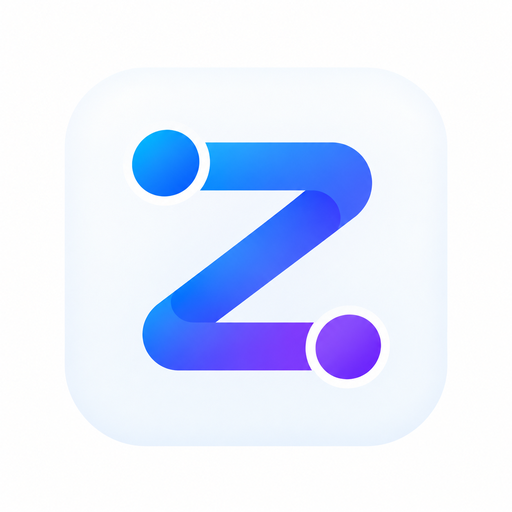
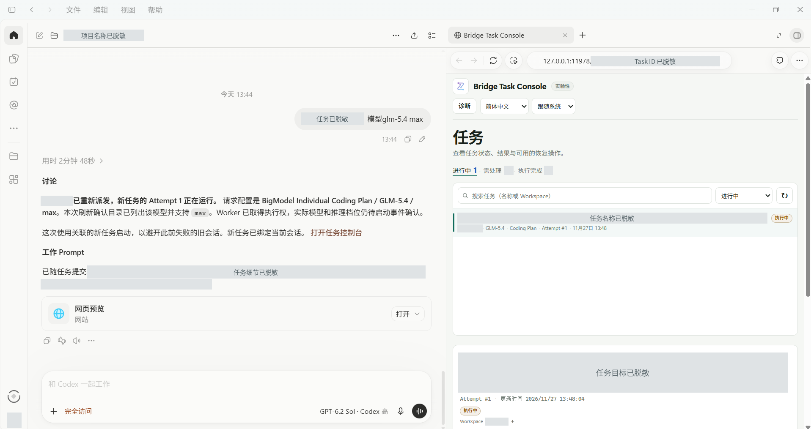
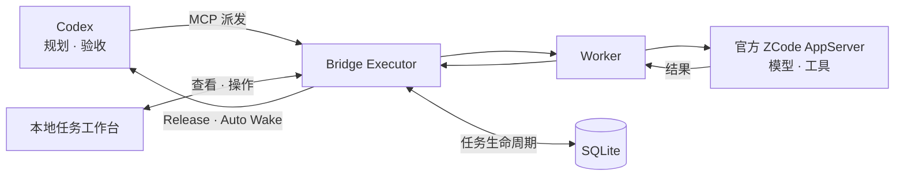

<p align="center">
  
</p>
<h1 align="center">Codex ZCode Bridge</h1>
<p align="center"><strong>Codex 规划与验收，ZCode 执行，Bridge 让任务持续推进。</strong></p>
<p align="center">
  
</p>
<p align="center"><sub>任务执行期间截取的真实 Bridge 任务工作台界面，已脱敏；界面仍显示“实验性”标签，项目名称、任务 ID、任务名称、提示词、任务目标与 Workspace 路径均已遮蔽。</sub></p>
<p align="center">
  <a href="README.md">English</a> · <a href="https://github.com/Sandyzzx/codex-zcode-bridge/releases">版本发布</a> · <a href="docs/WEB_CONSOLE.md">任务工作台</a> · <a href="docs/ZCODE_RUNTIME.md">排障指南</a>
</p>

Codex ZCode Bridge 是一个本地异步 Agent 协作插件。将开发任务委派给本机官方 ZCode Runtime，让 ZCode 在后台执行，Codex 不必持续等待。任务结束后，回到原 Codex 会话进行独立审查与验收。

## 为什么使用 Bridge？

- **委派完整目标，而不是单条命令。** Codex 定义目标、范围和验收条件，ZCode 使用自己的 AppServer 完成实现与测试。
- **异步执行。** 独立 Executor 管理已受理的任务，Codex 不必持续轮询等待 ZCode 完成。
- **保留任务历史。** SQLite 持久化 Attempt、进度、结果与清理事实，重新连接后可查看任务，不必盲目重新派发。
- **自动回到原会话。** 任务 Release 后，Auto Wake 请求恢复原 Codex 会话，读取结果、独立验收，并在需要时安排返工。
- **动态发现模型。** 从官方 AppServer 获取当前模型，选择套餐与推理档位，或设置默认模型。Bridge 不维护模型白名单。

## 快速开始

**环境要求：** Windows x64、Node.js 24.16.0（已验证版本）、Git、支持插件的 Codex，以及独立安装并登录的官方 ZCode Desktop。账户必须拥有所选模型的合法使用权限。

### 安装

安装 Stable 2.0.0：

```sh
codex plugin marketplace add https://github.com/Sandyzzx/codex-zcode-bridge.git --ref codex-zcode-bridge-v2.0.0
codex plugin add codex-zcode-bridge@codex-zcode-bridge
```

安装固定在已发布的版本，同一 Codex 环境中请只启用一份 Bridge 插件。

安装后开启新的 Codex 会话，审查插件的 `SessionStart` Hook。若遇到配置问题，可让 Codex 执行 `zcode_doctor`。通过 Marketplace 安装无需克隆源码或执行 `npm install`。

## 派发第一个任务

在 Codex 中打开项目，直接输入：

> 使用 ZCode Bridge，通过 Coding Plan 修复失败的解析器测试。只修改解析器及相关测试，运行定向测试，最后由 Codex 独立检查 Diff 和测试结果。不要提交或推送。

也可以明确指定当前运行时可用的模型和推理档位，例如 `GLM-5.4 / low`。只有用户明确要求派发，或已有明确授权覆盖当前目标时，Bridge 才会委派任务。

## 工作原理



Bridge 负责任务编排，不是模型 API 转发代理。Codex 负责独立验收，Worker 报告 `completed` 不等于代码已经验收通过。

## 任务工作台

点击任务回执中的本地控制台链接，即可查看任务状态、Attempt 历史、执行结果、已观测 Token 用量与失败原因。工作台提供受支持的任务操作、搜索、中英文与明暗主题；Runtime 和成本证据检查位于 Diagnostics。打开页面本身不会发送模型请求。

工作台通过同一个 Executor 访问 SQLite，不维护第二套任务状态。对于符合条件的异常任务，用户可以明确授权释放未验证清理的占用。这只解除 Bridge 的逻辑占用，不证明进程已经停止；可能仍有 Worker 写入工作区。

## 模型与套餐

| 套餐 | 2.x 支持情况 |
| --- | --- |
| Individual Coding Plan | 通过已安装的官方 AppServer 执行授权模型请求。稳定版发布准备期间已在 Windows 完成 GLM-5.4 / low 真实执行。 |
| Start Plan | 保留技术适配及 `-StartPlan` 选择别名。当前账户真实可用性尚未验证，实际使用受官方访问限制约束。 |

Bridge 使用官方当前本地 Provider 配置，通过 AppServer 动态发现模型。不授予套餐权益，不绕过官方访问限制，也不保证促销折扣。

用户明确指定的套餐和模型优先。只指定模型时，如果两种套餐均提供该型号，优先 Start Plan；如果仅一种套餐提供，则选择该套餐。目标模型不可用或被官方拒绝时明确报告，不静默切换模型或套餐。

## 已验证范围

Stable 2.0.0 的发布门禁通过了 Windows 与 Ubuntu 测试矩阵。其未变更的 2.0 运行时基线曾在 Stable 打包前完成 Windows 上 Coding Plan / GLM-5.4 / low 真实任务，包括文件创建、Result、Cleanup、Release 和 Auto Wake。GLM-5.4 / max 也通过了零模型 Turn 的设置与回读。Stable 发布不重复真实模型执行；此前真实 Host 测试已验证完成 Wake 和验收驱动返工。

历史已验证的 ZCode Desktop 版本包括 3.18.2.10443、3.19.0.10774、4.0.0.10870，各自验证范围不同。其他通过安全检查的安装可以尝试运行，不设置静态版本白名单，但不保证兼容。详见[运行环境说明](docs/ZCODE_RUNTIME.md)。

Stable 2.0.0 发布版的真实 Continue、当前 Start Plan 权益与执行、Desktop 完全退出后的恢复、Host 未加载时的 Wake，以及 Windows 重启恢复，仍未由最新发布证据验证。Ubuntu CI 不代表 Linux 或 macOS 的真实生产支持。

## 安全与升级

- **仅适用于可信本地单用户环境。** ZCode 使用当前系统账户权限。任务路径约束和 Git Worktree 不是 OS 沙箱；不要在任务提示词中放入凭据。
- **安装并启用 2.x 插件即默认启用 Auto Wake。** 自动唤醒可能消耗额外 Codex 用量；可在工作台 Diagnostics 中关闭。Queue ACK 不保证所有 Host 状态下都能启动新 Turn。
- **谨慎升级。** 升级前结束或停止正在执行的任务。2.x 仅支持 SQLite v14，旧 Schema 会被非破坏性拒绝。备份任务数据并阅读[升级指南](docs/ZCODE_RUNTIME.md)，不要假定旧插件能读取新增 Result 字段。
- **计费由服务商决定。** 不承诺倍率、免费额度或节省比例。没有实际结算证据时显示为未观测。

## 文档

[架构](docs/ARCHITECTURE.md) · [任务工作台](docs/WEB_CONSOLE.md) · [运行环境与升级](docs/ZCODE_RUNTIME.md) · [MCP 接口](docs/INTERFACES.md) · [安全说明](plugins/codex-zcode-bridge/SECURITY.md) · [开发文档](docs/README.md)

## 许可证

Apache-2.0，见 [LICENSE](LICENSE) 和 [NOTICE](NOTICE)。本项目是独立集成工具，并非 Codex 或 ZCode 官方产品。

## 写在最后

这个项目最初是为了让 Codex 与 ZCode 更高效地协作。很高兴最终把这个想法变成了一个可以实际使用的工具。

不过，在我的实际开发工作中，GLM-5.4 的表现没有达到预期。据我观察，ZCode 原有的 0.67 计费倍率优惠已经取消，Start Plan 的发放也较之前有所减少。我已经不再使用 ZCode。

本项目仍将保持开源，但今后不再进行常规维护，也不再保证及时修复问题、适配新版本或回复 Issue。如果你觉得这个项目有价值，欢迎 Fork 并继续开发。

感谢所有使用和支持过这个项目的人。
