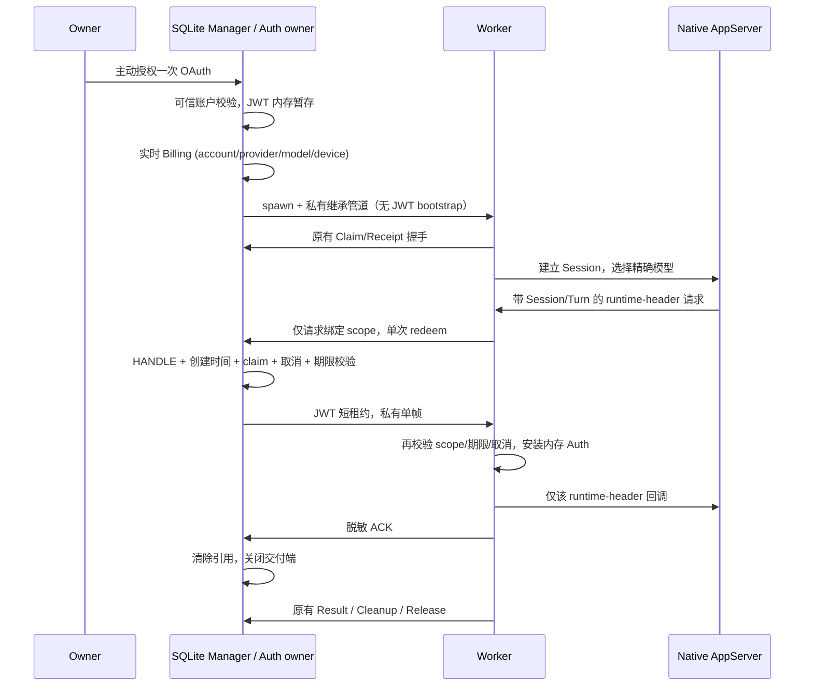

# Start Plan Gate 2：一次性 Worker 凭据交付

> Status: RESEARCH
> Date: 2026-11-03
> Baseline: 67dd8c67275c4afeb81dd9795ee03e258083c54d
> Gate: PARTIAL / NOT APPROVED FOR IMPLEMENTATION

## 方案选择

| 方案 | 身份与隔离 | 一次性/崩溃 | 泄漏及 Node24 复杂度 |
| --- | --- | --- | --- |
| Windows Named Pipe | 必须 ACL + GetNamedPipeClientProcessId + 进程句柄创建时间；Node net 不直接暴露完整验收能力 | 单连接单帧，关闭服务端撤销未交付租约 | 名称可发现，需 native helper，复杂度高 |
| 新增继承管道 | Manager 创建特定 ChildProcess 时传递专有句柄，无监听名；需持有该 Worker 进程句柄并验证创建时间 | 单帧、ACK 后关闭；exit/close 撤销；父死亡用管道 EOF 触发 Worker 撤销 | 不进入 argv/env；Node stdio 可用，但 Windows 底层可能为 socket/命名管道，并非声称匿名内核对象；复杂度中 |
| Node fork IPC | 仅父子，具备消息通道；仍需精确进程身份验收 | 消息 ID + 单次状态 + disconnect 撤销 | 容易误用普通消息日志/序列化；与当前 spawn 改动较大 |

首选新增继承管道。不得复用现有 bootstrap FD3 或交互 FD7/8/9，须在正式实现时分配并核对所有 FD；不向无关子进程继承句柄。继承关系是通道能力证据，Worker 自报 PID 不是独立认证证据。

Windows 最终身份方案：Manager 在 spawn 后打开并持有精确 Worker 进程 HANDLE，通过 GetProcessTimes 核对创建时间，绑定原 launch receipt/claim generation，交付前通过同一 HANDLE 确认仍活着。句柄持有防止该 PID 被复用；退出、未知、helper 丢失均拒绝交付。当前 POC 仅 PowerShell StartTime.Ticks 快照，**未实现 HANDLE 持有，因此不满足最终身份门禁**。

## 时序

若原生 runtime 在可用 Turn 之前要求认证，不得放宽 Turn 校验：需本地协议确认如何将 send-boundary generation 绑定到真实 Turn；目前 NOT VERIFIED。

## Threat Model

防范：意外跨任务泄漏、PID 复用、旧 attempt/Session/Turn 重放、并发消费、过期、取消、父子进程崩溃、未知 OS 身份，以及误将秘密放入持久化。

不承诺抵御同 Windows 用户的管理员调试、内存转储、恶意注入或受控 Worker 主动窃密。JWT 是字符串，清引用和 Buffer 清零均不能保证 GC、复制或 OS 内存立即物理擦除。Node 层继承句柄隔离与生产包装器的实际句柄继承还需独立验证。

交付是不可逆边界：写入前取消必须零交付；写入后取消关闭通道并令 Worker 的 Auth 状态失效，不能收回已发送字节，也不能撤回已发出的 Provider 请求。Worker 每个 runtime-header 回调及发送前均检查短租约、取消、精确 scope，禁止缓存跨任务 JWT。父管道 EOF、Worker exit、超时都失效，不重发。

## 接口合同

`Scope = {account, provider, model, task, attempt, session, turn}`；字符串必须非空，attempt 为正整数。额外正式绑定含 operation_id、generation、launch_id、receipt digest 和可信进程创建时间。

`LiveEntitlement.check(authenticatedIdentity, exactSelection, deviceContext, AbortSignal)` 为可信 composition 私有依赖；不可接受 Task 或 MCP 提供的 entitlement=true。它只在认证成功后执行当前请求，不能读取旧权益缓存。返回 discriminated status、模型事实、observedAt、服务端 request ID，JWT 不在返回结果中。成功 proof 是模块内不可伪造、不可序列化、一次性的短寿命 capability。

`Lease.issue(proof, credential, immutableScope, verifiedWorker)`：仅当前实时 proof 可签发；最长期限为 JWT 已知期限与短期交付期限之最小值。未知有效期不是服务端验证，必须显式限期并标注来源。Worker 在消费及后续使用时再次校验。

`Lease.redeem(scope, workerIdentity, signal)`：原子 active→verifying→consumed，竞争请求只拒绝自身，不撤销已获准的消费；校验失败 terminal revoke。一次写入无重发，ACK 丢失为 unknown，不再次交付。

失败分类：auth_rejected(401)、forbidden(403)、rate_limited(429)、unusual_activity(明确 code/message)、quota_exhausted(明确额度事实)、no_entitlement、model_unavailable、identity_mismatch、expired、cancelled、timeout、provider_error、unknown。HTTP 状态不能单独证明额度耗尽。所有认证/权益失败本阶段均不自动重试；Owner 再次授权属于新流程，不能隐式刷新或切换身份。

## Device Identity（观测，不是长期合同）

来源：历史 Worktree `START_PLAN_DEVICE_ID_ROOT_CAUSE.md`、`src/startplan/observed.ts`、`e2e/run-real-e2e.mjs`。Observed Desktop 3.16.3.8992 / CLI 0.17.0，源码 aac4755666d09fdcd70272fcf063c077a639015f。未重新读取生产凭据或执行网络请求。

- Desktop `desktopDeviceMid.ts` 缺值才生成，保存 telemetry-state.json，跨进程复用；CLI `cli-device-mid.ts` 读取同 data root 的状态，缺失才持久化并用锁协调。
- Desktop NodeApiClient 可从同一状态添加设备头；CLI/Bridge OAuth init/poll 的历史实测未带该头，poll token 是每 flow 的随机认证材料，不是 deviceMid。
- 历史 Billing 脚本每 run 生成 UUID，仅进程内复用；Worker 使用另一个隔离 data root 的持久 ID。不得直接移植此行为。
- 正式设计要求经 Owner 指定且可追溯的稳定设备上下文；Billing 与该 Worker 的 metadata 来源必须一致，不能用随机新身份处理限制。是否允许 Bridge 复用 Desktop 设备上下文、当前安装版行为、账号切换服务端绑定规则：NOT VERIFIED。账户切换清除全部旧 lease，device 不能跟账户切换随机轮换。
- 历史 ID 差异与封禁因果仍 UNCONFIRMED。无新的网络探测。

## SQLite 与当前 Master 差异

现有 worker-main.ts 直接构造 Adapter，独立进程且不经过旧 runWorkerTask。旧 worker-entry 的 JSON TaskStore 不移植。原 launch provenance/claim 握手保持不变，JWT 只经新增私有 channel，不能进入 bootstrap execution envelope 或 SQLite。

SQLite 仅保留 provider/model、非敏感认证阶段和关联 ID，不能保存 JWT、pipe payload、poll token 或可恢复 capability。Bridge 重启无 lease；Worker crash 撤销 Manager lease；Parent EOF 撤销 Worker Auth。Result/Cleanup/Release 由现有 SQLite 生命周期独立完成，认证失败不代表 cleanup 已完成。

## POC 与独立审查

目录内 lease.mjs / worker.mjs / lease.test.mjs 均离线，不被生产导入。使用合成 SYNTHETIC_ONLY，真实 Node 子进程，Windows Node 24.16.0。

第一轮：22 项，20 PASS / 2 FAIL（并发消费撤销正在验证的租约；真实管道身份测试失败）。并发问题已修复。第二轮：21 PASS / 1 FAIL；真实继承管道测试中 Worker PID 在 OS 验证时已不存在，不能作为成功身份交付证明。未将失败跳过或降低身份条件。

独立 Reviewer 发现：scope/identity 可变引用 TOCTOU、非有限 expiry、输入类型、写入后取消边界、Worker frame 解析、缺乏进程 HANDLE 持有，以及可信权益 adapter 只能证明编排。已修复前述可变快照和 credential expiry/type 校验；其余仍需完成。审查未放行。

## 下一阶段（仅 Gate 2 返修）

1. 诊断真实子进程 PID 与验证耗时；实现 Windows 持有 HANDLE 的身份检查，并证明 inherited endpoint 与原 ChildProcess 的绑定。
2. 加入严格单帧 UTF-8 解码、大小/额外帧拒绝、finite expiry、ACK 与端到端取消/EOF 状态机。
3. 增加 mutation/NaN、崩溃、父进程退出、异步写入取消、未 ACK、跨任务并发与零持久化测试。
4. 确认原生 Session/Turn 首次鉴权顺序；完成同一 device context 合同的证据核验。
5. 复跑并独立复审。上述未通过前，不进入正式 Start Plan 功能集成。

本阶段完整 npm/typecheck/build/validate 未运行：生产 TS 和 bundle 未改；POC 测试结果如上，不等同仓库回归。
