# Token Efficiency 基线

> Status: RESEARCH
> Last updated: 2026-11-21
> Verified against: `1f9ff9ef37528205e76156e13fe06ed2b1fd3711`
> Run: `phase0-20261121-a0`

## 冻结范围

| 项 | 冻结值或证据 |
|---|---|
| 仓库根目录 | `D:\codex-zcode-bridge` |
| A0 | 冻结时的 `origin/preview` `1f9ff9ef37528205e76156e13fe06ed2b1fd3711` / tree `878c4b1f41731869495c84524642ed9468f44027` |
| 发布身份 | `2.0.0-preview.10`。GitHub Release 发布于 2026-11-21 12:06:54（Asia/Shanghai）。发布 Tag 指向 `c181ba075677bde1aa867346be0521c32754c63d`，A0 取更新的 Preview 分支头 |
| 构建环境 | Windows x64 / Node `24.16.0` / npm `11.13.0` / A0 `package-lock.json` |
| Master Host 本机观察 | Codex Desktop `26.1111.2228.0`，CLI `0.169.0-alpha.11.1`。A0 回放消费者为锁定的 MCP SDK |
| Worker Host 发布范围 | ZCode Desktop `3.18.2.10443`，固定 Official Host 来源 `fec975905a2abd4c07e35c40d51fa097a2258ec9` / AppServer `0.17.1` |
| Worker Host 本机观察 | Desktop `3.19.0.10774`，安装版 `resources/glm/zcode.cjs` SHA-256 `6b84e928d9258fe020c6ab8c75fa2c123b0cd658fe43c0ce141a13df677fb0ea`。此版本属于 ADR-042 的实验范围 |
| Cost Lab | `tools/cost-lab` tree `edfa1d61bf64f6a4ee1ca362b16534b30089300b`。回放运行标识 `phase0-20261121-a0`，官方 Verification ID 未生成 |
| Prompt 和 Skill | `src/prompts/task-prompt.ts` Git blob `002be7533011d52a595a05f1776086b3d43e7c1c`；Master `SKILL.md` blob `bafb8e026f0a78c22c4ec55160e2158e92880e27`。派发和监控参考文件的 blob 及工作树 SHA-256 在回放 JSON |
| MCP 目录 | 对 SDK 返回的 `tools/list` 对象按原顺序 `JSON.stringify` 后 SHA-256 `893e1f3fd82d0f108f97e80170fbd4d71b8b9597c822185f854ff67f920ef90d` |
| Provider、模型、推理档和价格 | 离线 A0 为固定合成响应。实际账单 A0 的 Master/Worker/辅助 Provider、有效模型版本、推理档和价格快照待冻结。Cost Lab 现有 Worker 验证默认 `account:bigmodel-individual-coding-plan` / `GLM-5.3-Flash` / `low` |
| 样本和判定 | 回放脚本内固定单文件输入、16 次相同 running、空 cursor/Attention、短/大 Result 和未完成错误。真实任务矩阵、缓存条件和验收规则见 A/B 报告 |

初始检查匹配远端 `preview`。远端 `master` 为 `fcbef9c689c3fb82ec36bb3d477a631eec343477`，主工作树在 `295727320cab86b071c23ddddd6e29306fa29e7f`，已存在 `M AGENTS.md` 和 `?? $null`。初始登记 44 个工作树，含已有 Token Efficiency 候选和多处独立 WIP。`cost` 聊天正在跟进同批候选。本轮产物位于独立 `.run/token-efficiency-phase0-audit-20261121`，以 A0 开出。GitHub 公共 PR 列表在检查时未列出该优化的开放 PR。

## 调用图

```mermaid
flowchart LR
    A["Master Host / Skill"] -->|"tools/list, tools/call"| B["createBridgeServer + MCP SDK"]
    B -->|"zcode_task → createTask"| C["SqliteLifecycleMcpAuthority"]
    C -->|"模型路由、验证、同 ID 等值重放"| D["SQLite v14 / lifecycle-gate"]
    D -->|"Admission → Launch Intent → permanent Claim"| E["worker-main"]
    E -->|"buildTaskPrompt / buildContinuePrompt"| F["OfficialAppServerWorkerAdapter"]
    F -->|"session/create 或 resume → subscribe → send"| G["安装版 AppServer / Provider"]
    G -->|"session events / turn.completed Usage"| F
    F -->|"回调与执行 outcome"| E
    E -->|"fd14 观测、fd6 Result，绑定 Claim"| D
    D -->|"独立 Cleanup proof → Release CAS"| D
    D -->|"Status / Events / Feedback / Result"| C
    C --> B
    B -->|"text + structuredContent"| A
    H["Cost Lab 机器 MCP Client"] --> B
    I["官方账单快照"] --> H
```



- 工具入口为 `zcode_task`。13 个默认工具包括 `zcode_status`、`zcode_result`、`zcode_events`、`zcode_feedback`、`zcode_continue`、`zcode_cancel` 和 `zcode_interaction_reply`。SDK 按 Zod 输入定义校验，Manager 继续验证任务、路由模型、校验实际 Workspace 和进行 SQLite 等值重放。显式 Provider/模型优先。同 ID 异输入返回 `TASK_ID_CONFLICT`。见 [MCP 注册](../../../src/mcp/server.ts) 和 [Manager](../../../src/manager/sqlite-lifecycle-mcp-authority.ts)。
- Worker 使用 TaskPackage 生成 Prompt，随后通过共享 Official Host Session Factory 进入安装版 AppServer。Bridge 控制发给 `session/send` 的正文。官方运行时的系统指令、工具组装、项目说明加载频率和最终 Provider 缓存前缀，本轮不确定。见 [Prompt](../../../src/prompts/task-prompt.ts)、[官方适配](../../../src/adapters/official-app-server-adapter.ts) 和 [Session 调用](../../../src/adapters/zcode-app-server-adapter.ts)。
- `runtime_task_events` 属于同一 Authority。Manager 从持久 Attempt/Operation/generation/Claim 绑定 fd14 的 Runtime observation。Raw Event 按 public cursor 合并不同持久来源。Result 由 `buildTaskResult` 构造并通过 fd6 提交。已提交 Result、Cleanup、Release 各有独立事实。见 [Worker](../../../src/worker/worker-main.ts)、[Store](../../../src/sqlite-candidate/wp6b2b1/store.mjs) 和 [生命周期](../../../src/store/lifecycle-gate.ts)。
- Cost Lab Web 的 runner 以机器 MCP Client 调用 `zcode_status` 等到终态，再读取 Result、Raw Events 并观察 Release。这些脚本轮询用于账单和生命周期取证。Master Skill 的路线为 `zcode_events` + `next_seq` + 可选长等/Attention。实际每次工具响应由 Host 注入模型的字段与频率仍不确定。见 [Cost Lab runner](../../../tools/cost-lab/production-verification-runner.mjs) 和 [Master 监控](../../../plugins/codex-zcode-bridge/skills/zcode-bridge/references/monitoring-and-approval.md)。

## 重复来源和回放

`o200k_base` 统计独立 JSON/文本片段的本地代理 Token。完整任务输入、缓存及价格以对应 Host/Provider 记录为准。回放通过实际 `createBridgeServer` 和 MCP SDK 序列化，TaskManager 响应、测试日志和重复次数固定。

| 载荷 | SDK 结果 UTF-8 bytes | 完整载荷代理 Token | 文本/结构化内容单独计数 |
|---|---:|---:|---:|
| 13 个工具的 `tools/list` | 33,099 | 7,747 | 逐工具数据见回放 JSON |
| `zcode_status` 相同 running | 660 | 248 | 126 / 98 |
| `zcode_events` 空 cursor 页 | 285 | 88 | 41 / 27 |
| `zcode_events` 空页及 Attention | 528 | 159 | 80 / 50 |
| `zcode_result` 短结果 | 1,035 | 332 | 169 / 120 |
| `zcode_result` 多文件及 1,200 行合成日志 | 246,234 | 55,403 | 27,725 / 27,594 |
| `TASK_NOT_FINISHED` | 185 | 46 | 9 / 17 |

- `tools/list` 在新连接中可重现相同名称和顺序。12 个工具广告输出 Schema，`zcode_interaction_reply` 缺省输出 Schema。最大单项为 `zcode_result`（1,390 proxy tokens）、`zcode_events`（1,325）和 `zcode_cancel`（906）。
- 16 次相同 `zcode_status` 的响应合计 3,968 个代理 Token。Status 每次返回 Task、时间、Attempt、PID 和可选错误/Observation。`updated_at` 来自从 cursor 0 读取至多 200 个事件中的最后一项。运行期 Observation 可使用新的时间和 digest，因此该字段和原始响应哈希都欠缺去重版本语义。
- Result 捕获正文可再次出现在测试详情、AgentReport 或事件文本。MCP 又同时供应格式化 JSON 文本和结构化对象。回放中一条短结果和大型日志的体量相差约 167 倍，指向按需 Evidence。
- Worker 新任务 Prompt 样本 697 proxy tokens，普通续作 1,970。只改 Task ID 时，在字符索引 24 已出现差异。续作嵌入最多 4,000 字符的上一 Result 和完整原始任务 Prompt。普通续作样本中的 `OUTPUT CONTRACT` 出现一次。系统前缀、动态任务内容和实际缓存状态需在 Provider 请求边界核对。

## 用量与账单证据

| 数据层 | A0 可用来源 | 可信度与缺口 |
|---|---|---|
| MCP 载荷估算 | 两次 SDK 回放与本地 tokenizer | 确定性传输样本，各段代理 Token。Host 选择 text / structuredContent、序列化与重复注入频率未知 |
| 实际模型输入 | 未来使用授权的 Host 请求元数据或脱敏的请求级组装清单 | 需要按 request/response ID 关联工具定义、轮询、派发和结果。逐组件精确 Token 不确定 |
| Provider / Runtime Usage | Adapter `turn.completed` `.usage` → `normalizeUsage` → R7 / Result | Runtime 转报、有来源和 scope。Cache Read/Write、reasoning 允许缺失。当前 Cost Lab 从 Result 和 Events 选择一份 Usage，辅助请求覆盖有限。同一用量的多个投影按来源去重 |
| 实际费用 | Coding Plan 官方小时桶，前后账单匹配 Token 分类且无并发活动 | 同模型、账户、小时和结算窗口才能归因。短期零增量保持未知，时间倍率与活动倍率独立。Start Plan token unit、Coding Plan credits 和 Master 货币账单分别保留 |

2026-11-18 的既有 Coding Plan 生产 Worker E2E 记录了 22,657 uncached input、0 cached input、78 output、22,735 total 和 1.7666 官方 credits。该运行使用受支持的 3.18.2，覆盖 Worker 单次寻址，Master 及其他模型的同任务账单缺失。未合入 A0 的 Cost Lab Profiler `f798a73683f165800f447b5f0f4489f4b8cf0859` 记录过历史轮询归因样本（某完整 Goal 的 Master 用量中归因为轮询 27.74%），适合选择实验场景。其对应费用和可复用归因比例不确定。证据见 [历史 Worker 账单](../../evidence/coding-plan-official-discount-verification-20261118.md)。

本次 A0 的 `MasterCost`、`WorkerCost`、`OtherModelCost`、完整任务实际账单、实际输入/输出/缓存 Token、实际 MCP 上下文、可缓存分母、任务墙钟和真实任务验收率均为 `NOT_MEASURED`。

## 复现

以下命令在审计工作树的根目录运行。将同目录的 `replay-a0.mjs` 放在审计工作树的 `docs/research/token-efficiency-phase0-20261121/`。`js-tiktoken` 安装到运行目录，依赖安装使用冻结的项目包锁。

```powershell
$artifactRoot = '.run/phase0-20261121-a0'
New-Item -ItemType Directory -Force -Path "$artifactRoot/tokenizer" | Out-Null
$tempRoot = New-Item -ItemType Directory -Force -Path "$artifactRoot/tmp"
$env:TEMP = $tempRoot.FullName
$env:TMP = $tempRoot.FullName
$env:TMPDIR = $tempRoot.FullName
npm.cmd ci --no-audit --no-fund --cache "$artifactRoot/npm-cache"
npm.cmd run build:core
npm.cmd run build:test
npm.cmd install --prefix "$artifactRoot/tokenizer" --no-save --ignore-scripts --no-audit --no-fund --no-package-lock --cache "$artifactRoot/npm-cache" js-tiktoken@1.0.21
node docs/research/token-efficiency-phase0-20261121/replay-a0.mjs > "$artifactRoot/replay-a0-restored-default.json"
node docs/research/token-efficiency-phase0-20261121/replay-a0.mjs > "$artifactRoot/replay-a0-restored-default-repeat.json"
Get-FileHash "$artifactRoot/replay-a0-restored-default.json","$artifactRoot/replay-a0-restored-default-repeat.json"
```

恢复后的两份默认回放 SHA-256 均为 `3f17abf008c5093913282409101577b5adaa9d79c4a0f52326b6386c8f94cff9`，与 Phase 0 冻结值一致。字段级数据、13 工具统计、Prompt 哈希和 blob 位于审计工作树的运行目录。A0 回放计数为模型请求 0、账单 RPC 0、Worker Spawn 0。
