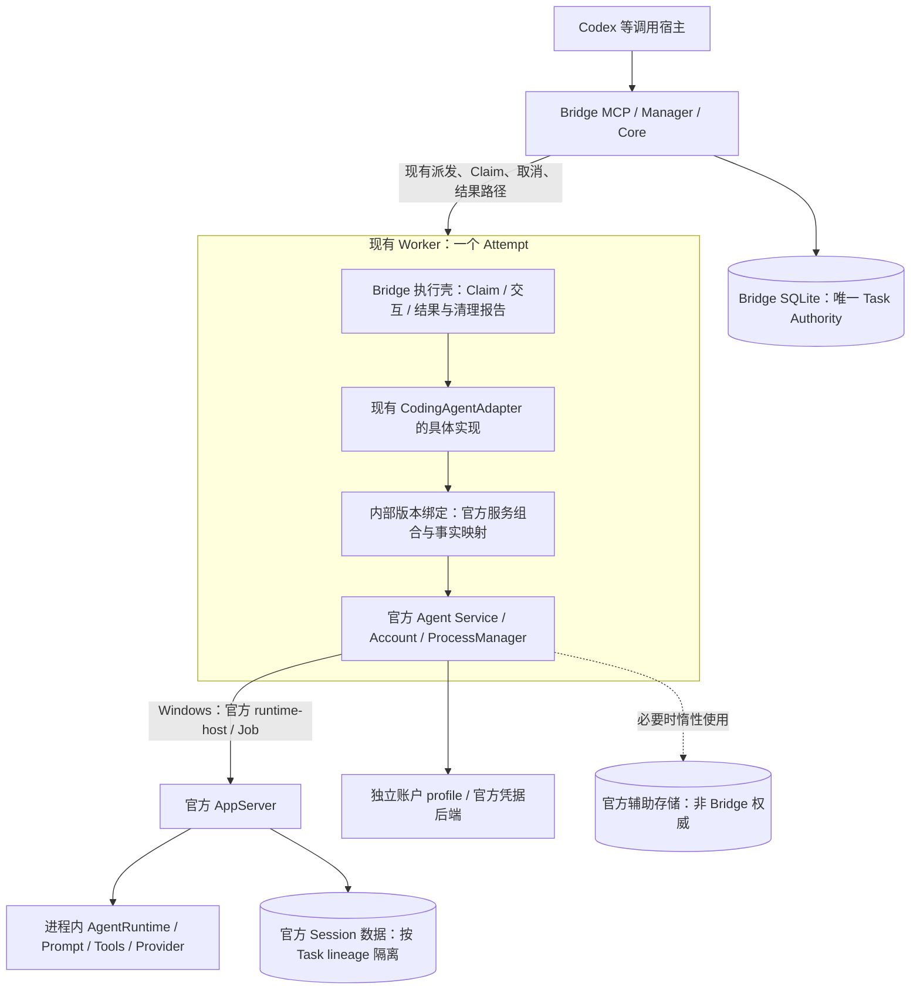
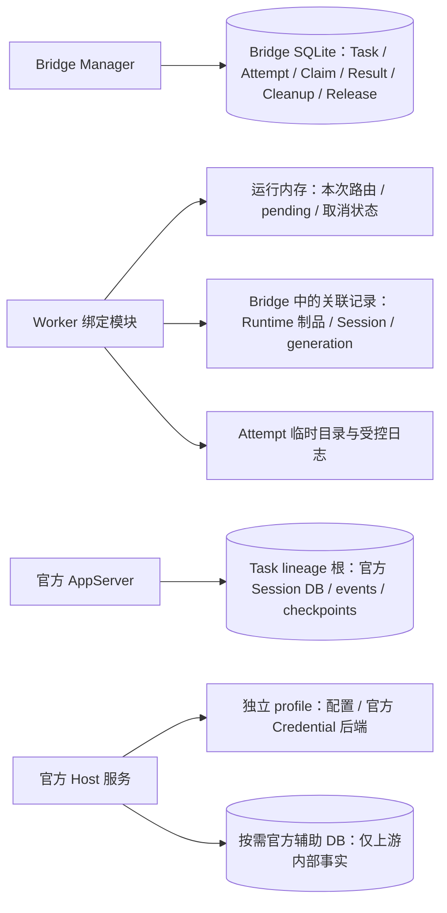

# ZCode Companion 与 Bridge 集成：独立架构审查

> Applicability (2026-11-12): HISTORICAL / SUPERSEDED FOR THE CURRENT TARGET. 独立 Companion 方向已由 [ADR-032](../../decisions/ADR-032-existing-worker-official-host-integration.md) 排除，当前源码候选改为在现有 Worker 内装配官方 Host。正文保留为冻结前研究；其中关于“尚未实现/未构建/未验证”的旧状态只适用于该研究时点，不能覆盖 [当前架构](../../ARCHITECTURE.md)、ADR-033/034 或本仓库的当前证据。

> Status: RESEARCH — 独立建议，未批准的设计合同，不修改现行 ADR。
> Date / Last verified: 2026-11-12（历史研究截止 2026-11-11），Asia/Shanghai。
> 审查范围：固定 Preview 源码、固定公开 ZCode 源码、前轮报告和运行证据；本轮未构建、未启动 Runtime、未访问真实账户。
> Bridge: `52015d12f37011f4d389e07941c31491457611ef` / tree `6a6d8db0731f21817996f3078910ed96091e2d6b`。
> Observed ZCode source: `b95ebaffeab641907b38652f45c1502bd762972d` / tree `d7ebeb994cb8f46b16761fc9c550ae3f6e039c3d`，3.18.0。
> 安装版及历史实验：Desktop 3.17.2.9661 / AppServer 0.17.1 / Node 24.16.0 / Windows 11 x64。不是 3.18.0 完整构建证据。

## 1. Executive Summary

```text
ARCHITECTURE_VERDICT: SIMPLIFY
TECHNICAL_FEASIBILITY: PARTIAL
OVERENGINEERING: MEDIUM
LONG_TERM_MAINTAINABILITY: MEDIUM
RECOMMENDED_ARCHITECTURE: 方案 5 — 现有单 Attempt Worker + 进程内官方 Host 组合 + 固定版本 AppServer 制品
IMPLEMENTATION_AUTHORIZED_OR_PERFORMED: NO
```

**我会保留 Bridge 已有 Worker，将 Companion 的薄 Host 职责合并进 Worker，复用官方 Agent Service/ProcessManager 和账户服务，以一个内部版本绑定模块隔离上游；初始每个 Worker 只拥有一个执行 AppServer，不新增常驻 Companion。** 固定源码构建、独立分发和版本回滚是制品边界，不必成为新的服务进程边界。

这不是把官方 AgentRuntime 嵌入 Bridge Core。AgentRuntime、Prompt、Tools 和模型执行仍在官方 AppServer 内；Bridge Core 继续拥有 Task/Attempt、调度和权威状态。推荐方案是方案 2 的受限形式，并对其版本、数据、进程、账号边界作明确约束。

独立 Companion 的真实潜在收益是：需要与 Worker 使用不同 Node/原生 ABI 时隔离运行环境；需要跨 Worker 的唯一账户刷新所有者时集中管理；需要共享昂贵 Host 状态时减少重复初始化。这些收益目前**尚未被证据证明是必须的**。当前 Worker 已隔离主 Bridge 与执行任务。再增加一个每任务 Companion，并不自动解决凭据供给、上游私有 API、依赖闭包或进程树清理。

不能给完整 PASS 的具体原因是：

1. **源码制品未构建。** 3.18.0 Host 装配、原生模块、Windows runtime-host 和资源闭包没有实际制品证明；0.17.1 Mock 运行不能填补这一项。
2. **账户闭环未成立。** 独立登录/供给、权益事实、刷新失效和同账户多 Worker 竞争没有端到端验证。公开请求验证实现和 CUA 实现还有明确功能缺口。
3. **最小 Host 不是现成轻量 SDK。** 可组合的导出存在，但高层工厂携带额外服务、默认配置和存储职责；裁剪后的完整接线尚未验证。
4. **官方清理与 Bridge Release 之间缺合同映射。** 官方 Windows Job 模型有源码实现，但未证明其证据能被固定 Preview 接受，也没有本轮硬崩溃/全工具后代测试。

建议允许后续另行批准的、仅 Mock 的最小 POC 来裁决上述路径；**不批准生产替换，不批准删除现行认证/清理合同，也不以重新跑安装版单文件实验代替源码制品验证。**

## 2. 基线、审查方法与证据级别

已确认项目根为 `D:/codex-zcode-bridge`。本轮未 checkout、fetch 或更新 refs。

| 对象 | 本轮只读核实 | 审查含义 |
|---|---|---|
| 当前根工作区 | master `aabbb0a959ee234508c62731ed5122f28dfcf5b0`，有既有 WIP | 不用它替代固定 Preview |
| 固定 Preview | 上述 commit/tree；已有 detached `bridge-source` 工作区干净 | 本报告 Bridge 源码依据 |
| master 与固定 Preview | merge-base 为 master；左右独有提交数 `0 / 15` | 固定 Preview 比 master 多 15 个提交 |
| 本地 origin/preview | `0b70edbbfb1888666d8d3b97f891a0f943fa3a9e`；比固定 Preview 多 8 个提交 | 仅本地 tracking ref，不宣称本轮查询了远端最新 HEAD |
| 旧 startplan 分支 | `770b260d22b328df19863e719b4163f2ef4b7747`；固定 Preview/该分支独有数 `4 / 3` | 两者已分叉，不能互换；未修改该工作区 |
| 固定官方源码 | 上述 commit/tree；已有 detached `source` 工作区干净 | Observed 3.18.0 内部实现，不是稳定公开 SDK 承诺 |
| 安装版运行结论 | 阅读已有原始 JSON、报告与摘要；本轮重核其中 14 个报告/证据文件 hash，全匹配 | 历史实验可信度核对，不是本轮重跑 |
| 历史源码证据 | `source-evidence.json` 的 43 个文件 hash 与当前固定工作区全匹配 | 再结合本轮新增调用链阅读，不只引用报告结论 |

已有七份研究报告均已阅读，入口为 [前轮 FINAL_REPORT](D:/codex-zcode-bridge/.run/companion-runtime-validation-20261111/FINAL_REPORT.md)。其中“Owner 已选 Companion，保留该边界”是前轮工作前提，不是本轮约束。

本报告区分：**SOURCE** 为本轮源码确认；**INSTALLED** 为前轮安装文件证据；**RUNTIME-PRIOR** 为前轮实际实验，本轮只核对；**INFERENCE** 为设计推断；**UNVERIFIED / NOT_RUN** 为未验证。所有性能和评分均是架构判断，未做 RSS、CPU、吞吐基准。

## 3. 关键发现与必须修改的设计前提

### F1 — 独立分发不要求再新增一个服务进程

固定 Preview 已有单 Attempt Worker，并在 Worker 内创建 `ZCodeAppServerAdapter`。`CodingAgentAdapter` 已定义 start/continue/status/result/cancel；现行 Worker 本来就负责运行 Adapter、交互和提交执行结果。证据：[interfaces.ts:181](D:/codex-zcode-bridge/.run/companion-runtime-validation-20261111/bridge-source/src/interfaces.ts:181)、[worker-main.ts:445](D:/codex-zcode-bridge/.run/companion-runtime-validation-20261111/bridge-source/src/worker/worker-main.ts:445)。

**建议：MERGE Companion Host into Worker。** 沿现有接口增加一个具体实现即可，不再建立平行 `RuntimeAdapter` 抽象层。将官方服务及内部绑定构建成固定版本制品，Worker 在启动时绑定一个版本；Bridge Core 不导入官方包。这能隔离大多数上游类型/协议变化，但不能承诺 Worker 的 Node ABI 永远兼容。

仅当 POC 证明 ABI 冲突无法通过已支持的共同 Node 版本解决、官方 Host 状态必须跨 Worker 常驻，或共享账号刷新确需唯一长驻所有者，才重新考虑方案 3。届时应写明新增进程解决的具体问题，不预先建设 daemon、注册中心和重连框架。

### F2 — 完整官方 Host 和轻量执行服务不是同一件事

SOURCE：[node.ts:3575](D:/codex-zcode-bridge/.run/companion-runtime-validation-20261111/source/packages/services/src/node.ts:3575) 的 `createServerHostServices` 初始化 credential cipher、设备身份、应用存储迁移和 workspace alias，然后调用 `createLocalServices`。后者会初始化进程环境、自签 CA，组合 Project、Task、Terminal 等服务；并为 Agent Service 接上 TaskIndex 预留、项目目录和工作区删除门。完整工厂确实摆脱 Electron Main，但并不符合“只启动一个 Agent”的最小职责。

SOURCE：[node.ts:180](D:/codex-zcode-bridge/.run/companion-runtime-validation-20261111/source/packages/services/src/node.ts:180) 导出 Agent Service/ProcessManager，另有 Credential、Account Request Auth 和 Provider 工厂。可组合性有实际导出和参数依据，不是根据类名猜测。

但 [zcodeAgentService.ts:1401](D:/codex-zcode-bridge/.run/companion-runtime-validation-20261111/source/packages/services/src/zcode-agent/zcodeAgentService.ts:1401) 内部仍创建 AutomationRepo、TaskIndexRepo 及 chat/plugin/mcp-status 三个 ProcessManager。**创建对象不等于已启动三个 AppServer，也不等于当场打开数据库**；AutomationRepo 的数据库初始化是惰性的。后续哪些 API 会触发这些资源，必须以选定能力的实际调用确认。

建议先组合官方导出的 Agent Service 与必要账户/配置服务，使用其会话及事件 API；不调用整个 Server/Local 工厂，不引入 Desktop Task/Project 调度。只暴露所需操作，不调用插件管理、MCP 状态探测等会创建额外进程的端口。若高层 API 的必要路径确实强制引入额外官方数据库，接受并隔离这份上游存储，比复制整个服务并删除代码更可维护；它不得成为第二个 Bridge Task Authority。

**不确定：**上述最小组合能否不依赖官方 TaskIndex 完成全部所需会话生命周期；目前只能证明源码有路径，不能宣布闭包已成立。如果高层服务的副作用无法隔离，优先请求上游提供窄入口；降到 ProcessManager + 小段协议绑定是有明确维护代价的次选，不能悄悄重新实现官方账户/Session 服务。

### F3 — 官方生命周期已足够丰富，但不能直接替代 Bridge 的完成证明

SOURCE：`ZCodeAgentProcessManager` 已实现并发启动收敛、workspace 绑定、代次阻止迟到启动、协议失败后的清理、有界 dispose，并通过 `getClient` 在需要时重建 Runtime。不是一个简单 `spawn` 包装。证据：[getClient:1051](D:/codex-zcode-bridge/.run/companion-runtime-validation-20261111/source/packages/services/src/zcode-agent/zcodeAgentProcessManager.ts:1051)、[timeout/close:1581](D:/codex-zcode-bridge/.run/companion-runtime-validation-20261111/source/packages/services/src/zcode-agent/zcodeAgentProcessManager.ts:1581)。

Windows 路径使用官方原生 runtime-host，helper 持有 Job；控制管道与模型 stdio 分离。其源码合同是 suspended 创建/归组、显式 start、EOF 宽限、Job 终止、ActiveProcesses=0、helper 退出；Host/helper 崩溃有相应内核/父句柄机制。见 [Windows runtime-host 合同](D:/codex-zcode-bridge/.run/companion-runtime-validation-20261111/source/packages/services/src/windows-runtime-host/CONTRACT.md)。本轮也核对了 [main.cpp:64](D:/codex-zcode-bridge/.run/companion-runtime-validation-20261111/source/scripts/windows-runtime-host/main.cpp:64) 的 KILL_ON_JOB_CLOSE、Job 属性归组、suspended 创建，以及后续父句柄/ActiveProcesses 判断。这比再写一套通用 Runtime Manager 有实际复用价值，但本轮没有运行该 helper。

固定 Preview 的 [buildExecutionCleanupProof:589](D:/codex-zcode-bridge/.run/companion-runtime-validation-20261111/bridge-source/src/worker/worker-main.ts:589) 接受的是现有收据/记录树扫描等明确证据形态。官方 `disposeAllAndWait()` 正常返回，不会自动生成这些合同要求的事实。**禁止把返回成功包装成伪造的旧树收据。** 应先通过 ADR 接纳可验证的 Job 归属/empty/退出证据，保留 Worker 自身关闭、Browser 和其它不在该 Job 内资源的独立检查。

官方 ProcessManager 管自己创建的 AppServer；Bridge Manager 管 Worker、Claim、Capacity 和 Release。这是不同对象的所有权，不是需要删除的重复。应删除的是两个 Manager 同时常规重启/杀同一个 AppServer。异常恢复仍须保留身份绑定的兜底，避免无人拥有的残留。

### F4 — 独立账户后端可实现，不等于独立账号已可用

SOURCE：Server/Standalone 有无 Main 的官方 cipher 路径。Desktop 默认则把 cipher 操作交给 Main，不能直接复制 Desktop Host bundle 就得到独立账户。Hosted AppServer 仍需 account overlay 与请求期 auth；Standalone 的现有账户路径也不能等同于完整 Start/Individual/Team 支持。

`resolver.ts` 要求 account `entitled === true`；官方 Request Auth Service 会按套餐、账户/项目和 revision 解析材料。前轮六项 Mock 只验证该模块的分流与失效条件。公开 `verification-policy.ts` 返回无需验证且交互不可用；`packages/zcode-cua/index.js` 返回能力不可用。**独立开源制品不能宣称与 Desktop 全功能等价。**

见 [resolver.ts:270](D:/codex-zcode-bridge/.run/companion-runtime-validation-20261111/source/packages/provider/src/resolver.ts:270)、[请求鉴权服务:81](D:/codex-zcode-bridge/.run/companion-runtime-validation-20261111/source/packages/services/src/model-provider/accountProviderRequestAuthService.ts:81)、[公开验证实现](D:/codex-zcode-bridge/.run/companion-runtime-validation-20261111/source/packages/shared/src/request-security-edition/verification-policy.ts)。

### F5 — 数据目录与服务进程数量都不能代替隔离合同

两个独立 Companion + 两套数据库的历史实验，支持独立实例隔离；没有证明共享 AppServer 多 workspace/session、共享账户刷新或共享 Host 数据根的并发安全。

Session 恢复要求持久保存其 lineage 数据，不能每个 Attempt 都换一份空数据库后仍承诺 `continue`。相反，取消某一个 Session 时不能为了省事销毁承载其他任务的共享 AppServer。初始采用“一个 Worker，一个执行 AppServer，一个活动任务 lineage”的模型，牺牲一些启动和内存成本，避免把共享池问题提前引入。

## 4. 最终推荐架构与组件职责



**最小合理数量：**保留三个运行职责——Bridge 控制面、现有 Worker 执行面、官方 AppServer 执行引擎。图中的 Adapter、Binding、官方 Host 是 Worker 内逻辑模块，不是三个服务。按一个活动 Attempt 计算，通常是 Bridge Node + Worker Node + AppServer Node；Windows 官方路径另有 runtime-host helper，即至少四个 OS 进程，尚未计工具后代。独立 Companion 会再多一个服务进程。不能把“减少一层服务”写成“最终只有两个进程”。

| 组件 | 唯一职责 | 不持有的权威 |
|---|---|---|
| Bridge Host/Core/Manager | 公共 MCP、任务授权、Workspace admission、调度、Task/Attempt、Result、Cleanup/Release | 上游模型执行、秘密材料、ZCode 私有协议 |
| 现有 Worker 执行壳 | 绑定一次 Attempt，消费取消/交互，提交事实；保持已有 Claim 和失联处理语义 | 不调度下一次 Attempt，不另建任务库 |
| 具体 CodingAgentAdapter + 内部 binding | Task 意图转会话操作，事件/错误/结果映射；固定版本装配 | 不实现新 Agent loop，不实现新 OAuth/权益算法 |
| 官方 Agent Service/ProcessManager | 官方会话协议、反向端口、所属 Runtime 正常生命周期 | Bridge 任务完成与 Capacity 释放 |
| 官方 AppServer | AgentRuntime、Prompt、工具、模型、Session/事件持久化 | Owner 验收、Bridge TaskResult |
| 官方 Account 服务 | 独立账户 profile 的凭据访问、刷新、权益快照、请求级材料 | 不读取 Desktop 账户数据库作为快捷入口 |

保持 Bridge Manager 与 Worker 的现有生命周期关系：不能新增“Manager 连接断开就杀 Worker”的行为来破坏当前 detached Worker/Recovery 语义。Worker 退出才触发它所拥有的官方 Runtime 关闭；主 Bridge 重启如何观察正在运行的 Worker，继续遵循现行合同。

## 5. 官方复用范围、Host 组合与 API 稳定性

| 模块 | 复用决定 | 可独立装配/依赖 | 当前证据 |
|---|---|---|---|
| AgentRuntime / Core | 必须复用 | 通过官方 AppServer/bootstrap，不自己 `new` 一套 Agent | SOURCE；0.17.1 基础 RUNTIME-PRIOR |
| Prompt / Context / Tools / Provider 执行 | 必须复用 | 官方配置和工具扩展闭包；Bridge 只提供任务要求/报告格式 | SOURCE；Read 有限 RUNTIME-PRIOR |
| Provider Registry / account overlay | 必须复用账户语义 | 同版本 builtin、personal、account 源；初始化后持续刷新 | SOURCE；完整真实账户 NOT_RUN |
| Agent Service / ProcessManager | 首选复用 | 由 `@zcode/services/node` 导出；请求鉴权与 verification 配置必须配对注入 | SOURCE；最小组合 NOT_RUN |
| Session / Event 服务 | 复用引擎存储及官方 Agent 会话/事件 API | 无须为了会话而导入完整 Desktop Task UI/项目管理 | SOURCE；独立 0.17.1 create/resume/replay 已有实验 |
| Runtime Configuration | 复用官方配置解析 | 明确 instruction/home/provider/log/storage/temp 解析根；不能只设一个 data env | SOURCE + 有限 RUNTIME-PRIOR |
| Credential / Account | 复用官方服务 | 无头系统后端存在；登录供给、刷新生命周期仍须装配 | SOURCE + 单模块 Mock |
| Permission / interaction | 官方请求机制 + Bridge 现有授权反馈端口 | 绑定 Attempt/Session/request，撤销后拒绝迟到答复 | SOURCE；新组合 E2E NOT_RUN |
| Browser | 独立后端为可选能力 | Desktop executor 默认依赖 Main；可注入明确的独立后端，缺省 unavailable | SOURCE；本 POC 关闭 |
| MCP / Skills / Memory / Subagent / Workflow | 保留官方实现，按能力逐项启用 | 不能因基础引擎成功就宣称全部可用；子会话须保持根任务授权 lineage | SOURCE；完整组合 NOT_RUN |
| Desktop Main/Renderer/Window/Updater | 不复用 | Electron parentPort、Main cipher/browser/UI 回调属于 Desktop 组合 | SOURCE / INSTALLED |
| 完整 Server Core/HTTP/部署 supervisor | 不直接搬入 | 可借鉴构建和装配；网络入口、远程部署和更新平台超出本地 Worker 需求 | SOURCE |

`@zcode/services` 和 `@zcode/bootstrap` 的 package.json 均为 `private: true`。这里“官方 API”只能指官方源码中可调用的导出，不代表发布在 npm 的受支持第三方 SDK，也没有跨版本兼容保证。通过导出入口组合优于大量 deep import；即便采用导出，也必须固定 commit 并编译验证。

最小依赖闭包目前稳定性**不确定**。Node 入口的广泛导入、动态插件/资源、原生模块以及应用服务的附带存储，不能仅凭 tree-shaking 或单 JS 文件成功来宣称已移除。允许官方内部有多个 ProcessManager 对象，不要求为了类数量美观修改上游；限制的是对外能力和实际创建的进程。

## 6. 账户、凭据与权益所有权

| 路径 | 收益 | 代价/缺口 | 决定 |
|---|---|---|---|
| A 执行端持有独立账户 profile 和官方凭据服务 | 不依赖 Desktop；请求材料留在执行端；Desktop 可独立升级 | 需要独立供给/登录、系统后端、刷新与失效接线 | **长期首选**；推荐方案中持有者是 Worker 内官方服务，不要求 Companion |
| B Desktop 最小 Credential Broker | 可复用 Desktop 已登录身份和 Main 系统库 owner | 依赖 Desktop 存活、版本、账号切换与自定义 IPC；没有已确认的稳定外部 broker 合同 | 不作长期默认；仅在产品明确要求单点登录时另立项 |
| C 官方既有供给机制 | Personal/API-key 配置可用于支持的 Provider；源码有独立 CLI/Server、Provider Provisioning | Standalone 账户路径不等价全部套餐；Provisioning 要认证来源/目标并处理回滚，不等于任意导出 Desktop 凭据 | 可作为 A 的供给方式；逐 Provider 验证，不能替代账户验收 |

建议的所有权链是：用户显式为 Bridge 执行端准备独立 profile → 官方 Credential/OAuth 服务管理该 profile → 官方 Account/Provider Source 产生 account snapshot 和 entitlement → 同一次模型请求按 account/project/revision 解析 runtime headers → 官方 Provider 发请求。Bridge Core 只保存不透明 profile 标识、非秘密可用性和失败分类。

这是对固定 Preview 当前父端私有认证供给链的迁移建议，不是已实现事实。不得同时保留“父端租约/Billing”和“Worker 官方账户 owner”两条自动择优认证链。切换必须先批准凭据责任边界及 ADR-030 替代，再按明确配置采用唯一执行链；当前生产行为不因本报告改变。

“不读取凭据”在本轮审查中是绝对限制；未来架构中的意思应是**Bridge Core/报告/普通 IPC 不读取或传递秘密，受授权的官方凭据服务必须能读取自己拥有的材料**。若连官方服务也禁止读取自己的材料，则任何账户执行都不可能成立。它不授权本轮去读取真实数据。

需要保持的细节：

- `available / unavailable / unknown` 分开；JWT 存在、模型可列出、旧缓存均不证明权益。请求材料必须在使用时检查账号、组织/项目、scope 和 revision；不得只缓存一份整 turn 凭据。
- 配置更新或登出后，拒绝旧请求应答；把官方刷新逻辑作为唯一实现，不在 Bridge 重写刷新算法。
- 同一个账户 profile 的跨进程锁、token rotation 和 revision 传播尚未验证。凭据文件有锁不等于远端刷新事务跨进程安全。初始账户型 POC 每 profile 单活 Worker；这只是实验限制，若迁移生产会减少现有并发，必须明确产品取舍/ADR，不能静默上线。
- 若产品必须同账号多任务并发，而官方多进程模型验证失败，再比较一个独立账户 owner 或有明确收益的 Companion；不要通过复制 token 到每任务目录伪装隔离。
- 未来登录/刷新必须使用官方支持流程；不复制 Desktop DB/密文，不重建密钥推导，不手写 JWT/header 或伪造 device identity。

现行 [ADR-030](D:/codex-zcode-bridge/.run/companion-runtime-validation-20261111/bridge-source/docs/decisions/ADR-030-start-plan-provider-preflight.md) 的实时权益预检和租约前复核不可直接删除。目标应让官方 Account/Entitlement 成为唯一事实源，避免 Bridge 重复 Billing；但只有替代来源、时效、拒绝条件及请求级绑定均得到验证，并以新 ADR 替代条款后，才可移除旧链。**本报告不建议继续围绕 30 秒 TTL 打补丁，也不授权放弃权益门槛。**

## 7. 层次、Adapter 与过度设计清单

八项候选职责不等于八层运行时。Bridge Host/Core 原有分工有价值；Adapter 和 binding 的语义边界也有价值，但无须各自 package、服务、数据库和协议。

| 当前设计 | 价值 | 复杂度 | 建议 | 原因 |
|---|---|---|---|---|
| Companion | 可隔离 ABI、共享长驻账户/Host 状态 | 新启动/退出/版本/IPC/恢复路径；每任务形式重复 Worker | **MERGE** | 初始并入现有 Worker；只有测得不可替代收益才独立 |
| RuntimeAdapter | Bridge 意图与 Runtime 事实转换 | 与既有 CodingAgentAdapter 平行会重复 handle/生命周期 | **MERGE** | 实现现有接口，避免再包一层通用 Runtime 抽象 |
| UpstreamBinding | 限制上游 import、RPC/事件映射范围 | 小模块合理，独立包再增版本矩阵 | **KEEP** | Worker 内普通模块，与固定官方制品一起构建测试；暂不单独发布 package |
| IPC Contract | 跨进程取消、错误、关联和终态所必需 | 自建协议在合并 Worker 后无新承载对象 | **MERGE** | 复用现有 Bridge–Worker 路径、官方 Host–AppServer stdio；独立服务协议 DEFER |
| Companion SQLite | 自有 Task/Attempt 镜像几乎无价值 | 双权威、恢复冲突、迁移与回滚成本 | **REMOVE** | 不增加自有业务库；保留官方确实需要的存储 |
| 多层 Process Manager | 管不同归属对象是必要的 | 同时管理同一 Runtime 会产生重启/杀进程竞态 | **MERGE** | 官方独占 AppServer 正常管理；Bridge 保留 Worker/Release 和明确恢复兜底 |
| 完整 Official Host 工厂 | 接线现成 | 迁移、CA、设备、Task/Project/终端/后台能力过宽 | **DEFER** | 优先使用导出服务的受限组合；确需附带功能时记录原因 |
| Shared AppServer / Pool | 可能降低初始化成本 | workspace/账户/session/取消/故障域交织 | **DEFER** | 没有性能基准或共享并发证明 |
| 动态版本协商/服务发现 | 远程多客户端部署有用 | 单用户固定配套制品用不上 | **REMOVE** | 固定 manifest/接口版本检查即可 |
| 自动重连/自动重发任务 | 掩盖暂时连接故障 | 可能重复产生模型/文件副作用 | **REMOVE** | 连接断开记录接受状态未知，禁止重发；显式恢复走原 Bridge 合同 |
| 多级 ACK / 双写状态 | 特殊传递保证有用 | 把所有消息做持久确认会重复当前交互合同 | **DEFER** | 新层只保留必要接受事实；已有敏感交互 ACK 未经合同替代不得删除 |

Adapter 方案比较：

| 方案 | 自维护代码/测试成本 | 上游隔离 | 结论 |
|---|---|---|---|
| A 新 RuntimeAdapter 再调用 Companion IPC | 两端序列化、两种 handle、两组错误/取消测试 | 可以隔离，但层数本身不提升语义稳定性 | 不推荐作为默认 |
| B 既有具体 Adapter 直接负责 IPC | 若独立 Companion 必须存在，这是最短接入 | IPC 稳定时良好 | 独立服务备选首选 |
| C Companion 接近 Bridge Task Contract | 减少 TaskPackage 来回转换 | 若开始管理 Task 状态/SQLite，就破坏权威边界 | 只可接收执行请求，不能变成第二 TaskManager |
| D 本报告：具体 Adapter → 进程内 binding → 官方服务 | 无新增 wire 协议，仍需语义和官方制品集成测试 | 上游依赖限制在 Worker 制品与内部模块 | 推荐；牺牲 Worker 与 Host 的独立 ABI/崩溃边界 |

不估算未经实现的精确 LOC。实际减少的是一组协议 codec、一组进程启动/退出握手和一组服务恢复场景；不会消除账户、能力映射和清理测试。

## 8. 进程数量模型与 IPC

### 8.1 AppServer 分配

| 模型 | 隔离/故障范围 | 资源与管理代价 | 选择 |
|---|---|---|---|
| A 一 Companion 一 AppServer，一次一个任务 | 好；与单 Worker 模型接近 | 每任务额外 Host 进程；不自动获得共享收益 | 合并 Worker 后保留其一对一思想 |
| B 一 Companion 多 AppServer，每任务一个 | AppServer 故障局部，Companion 故障影响全部 | 集中账户可能有收益，但要 Runtime 路由、回收和多任务中断处理 | 延后 |
| C 一共享 AppServer，多 Session 并行 | Session 是逻辑隔离，不是 OS/进程故障隔离 | 少进程；单次强制清理影响其他任务；共享配置/账户/工作区需证明 | 延后；独立实例成功不证明此模型 |
| D 每 Worker 一个 AppServer | 贴合现有 Attempt/Claim、取消和故障归属 | Provider 初始化与内存随并发增长 | **初始推荐** |

一对一不保证只有一个 Session 对象：未来启用官方 Subagent 时，可有属于同一 Task lineage 的子 Session；不能引入第二个无关 Bridge Task。AppServer 崩溃使该 Attempt 进入失败/未知处理，不由官方自动重建能力触发 Prompt 重发。Binding 在 fatal/取消后锁存，不再调用会隐式创建进程的 `getClient` 执行原输入。

升级方向应先测启动时间、RSS、Provider 初始化占比，再考虑按独立账户/工作区分组的执行池；共享同一 AppServer 需要单独的并发、取消、配置变更、错误恢复和串用反例验证。

### 8.2 本地传输选择

| 传输 | 本地适用性 | 必要成本 | 决定 |
|---|---|---|---|
| stdio | 父子进程已建立的私有句柄、易绑定生命周期 | stdout 只放协议；长度/背压/EOF/错误处理 | 官方 Host–AppServer 保留；若以后拆 Companion，优先 inherited stdio |
| Windows Named Pipe | 原生 helper 已使用；也适合未来独立长驻服务 | ACL、唯一命名、连接归属和失联规则 | 保留官方内部实现；不为 Bridge 再建立一套 |
| Local Socket | 适合 Unix daemon；Windows 兼容实现需核对 | 地址/权限/发现/端口生命周期 | 当前无收益 |
| HTTP localhost | 便于多客户端/浏览器 | 监听、来源/鉴权、端口冲突、暴露面与重连 | 不因已有 Server HTTP 就搬来本地 Worker |

官方已用的 RPC 框架无需重写。需要删掉的是额外再造的通用本地微服务框架。单用户可信环境下，继承句柄无需另加令牌登录/服务注册；但消息仍需 schema、身份绑定、有界输入和错误处理。若以后采用可被其他进程连接的端点，则访问控制不能省略。

### 8.3 最小边界合同（设计建议，不是本轮新建协议）

推荐方案无新增 Worker–Companion IPC；以下是 Adapter/binding 的窄语义面。若将来必须拆进程，可原样序列化，而无需提前实现 RPC 框架：

| 操作/事实 | 最少语义 |
|---|---|
| Open / Ready | 制品 hash/版本、接口 major、能力、绑定的 Task/Attempt/Operation、workspace、profile 引用、可选 continuation Session；不含秘密 |
| Submit | 单个 inputId、Prompt/任务约束、已解析模型选择；返回 accepted/rejected，丢失应答为 unknown，禁止自动重发 |
| Event | runtime generation、Session/turn/input 关联、顺序号、类型、受控载荷；去重与缺口可见，不把未知 token usage 变成 0 |
| Interaction / Reply | 当前请求 ID、Attempt/Session/scope、取消/期限；已结束或换代拒绝迟到答复；已有 Bridge 持久交互合同继续有效 |
| Cancel | 针对已绑定执行，幂等接受意图；接受取消不等于工具停止或任务终态 |
| Outcome | succeeded/failed/cancelled/unknown 事实、原始结果类别的安全映射；`turn.completed` 不能单独表示成功 |
| Close / Resource facts | 停止 admission，关闭所属 Runtime，提供可验证进程身份及资源事实；cleanup verified/unverified 独立于 Outcome |

Open 已携带模型选择和 continuation，不需要另造 ModelService、SessionService 和 TaskService 三套外部协议。模型目录读取可沿既有 catalog 入口独立使用同一绑定，不得为读取目录意外启动任务、发 Billing 或访问未知账户。

接口版本初始使用固定配套 manifest + major/能力检查，不维护任意版本协商矩阵。传输若断开：停止接受新命令、保留已发生事实、取消/关闭自己资源；不假定最后请求未执行，不重连后重发。控制消息不应被无限日志/事件缓冲阻塞，限制单帧和待处理数量；取消与 Close 必须有界。准确限额在 POC 合同中确定，不在此发明一套新的通用限流体系。

## 9. 数据所有权与最少存储



| 数据 | 所有者/寿命 | 约束 |
|---|---|---|
| Bridge SQLite | 现有 Manager；产品持久数据 | 唯一业务 authority；不由 Companion 镜像其 Task/Attempt |
| 官方 Session SQLite | AppServer；Task lineage 持久数据 | 各独立任务根隔离；同任务 continuation 顺序复用原根/Session；无并发 writer 假设 |
| 官方 Host 辅助存储 | 选定官方服务；按实际闭包决定 | 不自行写 schema；不作为 Bridge 状态/成功依据；不能提前承诺物理数据库总数恒为二 |
| 账户 profile / 凭据 | 受授权的官方账户 owner | 不放 Bridge SQLite；不与 Desktop 共享；并发刷新待验证 |
| 配置 | profile 及同版本官方资源 | 数据路径可配置；不能把 Task 配置覆盖写回全局 Desktop 配置 |
| Session/Runtime 关联 | Bridge 已有执行证据，必要字段经 ADR 扩展 | 只存引用和 identity，避免复制 Session 内容形成第二套状态 |
| 临时文件 | Attempt | 结束后经归属核实清理；不能删除继续任务所需 Session 数据 |
| 日志/事件 | 官方运行日志与 Bridge 脱敏事件各有目的 | 有界保留；普通报告不携带 auth、device、原始私密请求；调试日志也不是权威状态 |
| 不可变制品 | 按版本安装目录 | 运行数据、生成 provider 配置不写进制品树 |

不增加自有 Companion SQLite。独立目录不一定意味着独立数据库：配置/日志/tmp 只需明确路径；官方服务真正要求数据库时保留其所有权和迁移，不能为满足“两个 DB”目标改写上游。

## 10. 五方案完整比较

评分 1–5，**5 为更有利**：复杂度 5 表示更简单、代码量 5 表示自维护更少、资源 5 表示预期开销更低。是有条件的相对判断，不是性能测试或可发布 PASS。方案 4 是部署策略，与其它拓扑并不正交；本表将其具体化为“Worker 调用安装引擎”，才可比较。

| 维度 | 1 直接 AppServer | 2 Worker 内官方 Host（未裁范围） | 3 独立 Companion | 4 Desktop 安装文件复用 | 5 受限 Worker Host + 固定制品 |
|---|---:|---:|---:|---:|---:|
| 技术可行性 | 4 | 3 | 3 | 4 | 3 |
| 架构复杂度 | 5 | 3 | 2 | 5 | 4 |
| 自维护代码量 | 2 | 4 | 3 | 2 | 4 |
| 上游兼容性 | 2 | 3 | 4 | 1 | 4 |
| 资源消耗 | 4 | 3 | 2 | 4 | 3 |
| 可靠性 | 3 | 3 | 3 | 2 | 3 |
| 账户接入 | 2 | 3 | 3 | 2 | 3 |
| 发布维护 | 3 | 2 | 2 | 1 | 3 |

不按加总机械选型；账户、源码构建和清理证据是门槛，不能用“组件少”抵消。

| 方案 | 主要判断及 Windows/生命周期影响 |
|---|---|
| 1 直接 AppServer | 基础路径已有历史实验和生产 Adapter；最少新增组件。问题是 Bridge 继续维护 Provider/account overlay、runtime auth 反向协议和上游事件兼容。若产品只需受限 API-key 执行，这是合理最小方案；不满足本任务减少官方 Host 能力重实现的长期目标。 |
| 2 Worker 内完整官方 Host | 没有新进程，官方逻辑复用充分；但完整 Server/Local 工厂带过多副作用和独立应用状态。共享 Worker Node/环境/事件循环，需要配置与 ABI 审核。不能无裁剪默认采用。 |
| 3 独立 Companion | Node/ABI 和 Host 崩溃隔离明确；若共享账号 owner/初始化成本有实证，值得保留。代价是新增 IPC、版本配对、服务所有权、失联和恢复。每任务 Companion 仍重复账户初始化；共享 Companion 又扩大故障范围。Windows 原生 helper 和清理验收仍必需。 |
| 4 Desktop Runtime 文件 | 引擎只读使用不必依赖 Main，0.17.1 基础已验证。没有解决完整账户；Desktop 更新/卸载与混合资源导致不可控依赖。不满足长期独立分发。仅作显式版本/hash 门禁的过渡实验来源。 |
| 5 本报告推荐 | 复用现有 Worker 和官方 Host 必要服务，制品独立固定；省去服务级 IPC/恢复，保留上游边界。最小组合仍须 POC；Host 崩溃会带走当前 Worker，但主 Bridge 保留其持久恢复能力。账户共享难题公开列为门槛，不用目录隔离掩盖。 |

另外考虑并拒绝“直接在 Worker 内运行 AgentRuntime、删除 AppServer”：虽然再少一个 Node 进程，但会把工具/模型执行、全局环境、退出和 native 故障带进 Worker，并绕开官方成熟的协议生命周期；不值得为少一个进程改变复用边界。

## 11. 固定源码构建、升级与再分发

**C 固定源码构建可作为长期方向，结论是有条件可持续，而非已经证明可发布。** 不需要维护完整 ZCode Fork；可把上游 commit/lockfile 当作只读构建输入，维护小型外部装配入口、binding、manifest 和平台构建配方。若每次升级都要修改官方账户、工具或大量 deep import，就已偏离目标，应停止并寻求上游入口，不把补丁堆称为薄适配。

SOURCE：官方 CLI 构建外置 `playwright-core`、`koffi`、`@napi-rs/keyring` 等；Server staging 有 Node、workspace 包、Native Tools、Windows runtime-host 和 notices 路径。源码 `mise.toml` 固定 Node **24.14.0** / pnpm **10.33.2**；前轮实验主机是 Node **24.16.0** / pnpm **11.25.0**。不能称两者已验证兼容构建；Worker 与制品需要明确支持的共同 Node/ABI，或实证说明必须分进程。

最小发行物应由实际 build metafile、外置模块/动态资源清单和能力测试导出，至少包括：绑定模块、匹配的官方 Host 和 AppServer、builtin 配置、声明能力所需工具/插件资源、平台原生 helper/模块、必要 Node 运行时约束、许可证和制品 manifest。复用官方 staging 不等于照搬完整 Server supervisor/HTTP/自动更新。

| 问题 | 审查回答 |
|---|---|
| 能否从官方仓库直接构建？ | 有官方构建路径；完整 3.18.0 Windows 制品 NOT_RUN。我们的小型装配入口仍需构建接线，不等于仓库已有现成 Companion 命令。 |
| 哪些直接引用？ | 官方导出的 Agent Service/ProcessManager、Account/Credential/Provider 服务、匹配 AppServer；按实际导出/闭包使用。 |
| 哪些必须适配？ | Bridge Task→Session、结果/事件、交互、能力、账号 profile 绑定、配置路径、生命周期证据与打包。 |
| 能否每次只改一个 Adapter？ | 不能保证。API/RPC 变化多在 binding；依赖/ABI/资源涉及构建；授权/终态变化可触及 Bridge 合同。 |
| 是否维护多个兼容版本？ | 初始只支持一个活动配套版本，保留一个已验证旧制品供回滚；不做任意 Desktop/Bridge/Host/AppServer 交叉矩阵。 |
| Desktop 能否独立升级？ | 若制品、profile、数据根完全独立，设计上可以；不依赖 Desktop 登录/安装目录。跨版本完整账户运行仍 NOT_RUN。 |

升级先离线构建并测制品，再在无活动/未知执行和未清理资源时切换新任务版本。活跃 Attempt 固定版本，不原地覆盖文件。初始不增加蓝绿服务、在线跨版本 Session 迁移或自动降级；旧 Session 需要旧版本时显式选择或拒绝，不静默改用另一个 Provider/引擎。

回滚必须检查 Session/Host DB schema、credential format/backend 和配置兼容。已迁移且不兼容的数据不能交给旧二进制；可保留旧根只读、拒绝 continuation 或另起明确的新 Session，但不能把 Bridge 权威库恢复成旧快照来消除已执行事实。账户状态不能靠恢复旧 token 文件回滚。

许可范围：根 LICENSE 是 Apache-2.0，第一方源码的复用分发有路径；必须保留许可/版权/适用 NOTICE、标记实际修改，不能暗示官方背书或取得商标授权。`THIRD-PARTY-NOTICES.md` 明示它是多个发行形态的保守并集，不是本产品精确 BOM。所列依赖存在 CC-BY-4.0、双许可及其它独立条款；例如 elkjs 的 EPL-2.0 OR GPL-3.0-or-later、jszip 的 MIT OR GPL、node-forge 的 BSD OR GPL，不能仅凭出现 GPL 字样判定所有制品同样受其约束，也不能一律按 Apache 分发。

未来应按实际打包集合选择适用许可并保留原文，核对 Native/Node/字体/插件和资源出处。**本轮没有完成最终制品 BOM 的逐项许可验收；不批准直接再分发整个 Desktop 安装包。** 源码包含公开占位能力，还说明开源构建并不承诺安装产品全部功能。

## 12. 必须保留的防御与可删除的复杂性

| 必须保留 | 原因 |
|---|---|
| Workspace admission、Attempt/Session/账号绑定 | 防串用和旧应答，不是公网上的租户隔离设计 |
| 独立数据根和明确 user/project instructions 来源 | 防污染真实 Desktop 与其它任务；单个 data env 不能包办 |
| 自己创建的进程所有权、helper/Runtime 身份区别 | 防误杀、PID 复用和遗漏后代 |
| Cancel intent、Runtime outcome、Cleanup、Release 分开 | 模型结束不等于外部工具已停止；资源未证明关闭不能释放路径 |
| Bridge 持久 Claim/恢复围栏 | Worker 崩溃后防重复执行/错误释放；不能为简化删除当前已解决的问题 |
| 秘密只在官方私有端口内使用、日志脱敏 | 本机可信也不等于秘密可以进入报告/模型/普通事件 |
| 有界输入、背压、超时与迟到拒绝 | 实际本地进程同样会损坏协议或阻塞 |

可删除/延后的复杂性：新服务发现、分布式 lease、一切消息多级 ACK、网络重连恢复平台、心跳套心跳、重复任务库、透传任意 upstream method 的“通用 API”。官方协议已有的关联/ACK 不为追求少字节而删除；Bridge 已有交互消费确认也须先有替代证明。

不新建 Companion Recovery 状态机。保留一个简单运行内存态：未开始→执行中→正在关闭→已关闭/关闭未验证；任务权威和历史恢复继续在 Bridge。官方内部状态机照常复用，不再做镜像。

## 13. 风险与未知项总表

| 项目 | 证据级别 | 当前结论/影响 |
|---|---|---|
| AgentRuntime 在 AppServer 内，外层 ProcessManager 创建它 | SOURCE；与 INSTALLED 调用链一致 | 已确认，不能画成 AgentRuntime 管理 AppServer |
| 0.17.1 独立文字/Read/回放/恢复/取消 | RUNTIME-PRIOR，本轮重核证据 | 有限通过；插件、Memory、MCP、Subagent 等关闭 |
| 两独立 Companion 互不影响 | RUNTIME-PRIOR | 限独立根与最终 r3；r2 退出失败未升级成 PASS |
| 3.18.0 最小官方 Host 可组装 | SOURCE + INFERENCE | 导出与参数路径成立，完整启动/构建尚未验证 |
| 辅助 DB、额外 ProcessManager 对象 | SOURCE | 已确认对象依赖；最小操作触发哪些资源不确定 |
| 独立系统凭据后端 | SOURCE | 有官方实现；真实 profile 供给/运行 NOT_RUN |
| Start/Individual/Team 分流 | 单源码模块 Mock RUNTIME-PRIOR | 不证明真实权益或安装版账号可复用 |
| Start Plan 完整开源能力 | SOURCE 显示验证 stub；真实服务 NOT_RUN | 不确定；若必要能力缺失，相关产品能力 BLOCKED，不能伪造支持 |
| CUA | SOURCE | 公开实现明确 unavailable，不列入支持范围 |
| 官方 Job 关闭与硬崩溃 | SOURCE | 合同和 helper 实现存在；完整 Windows 制品与所有工具后代 NOT_RUN |
| Shared AppServer 并行 / 共享账户多 Worker | UNVERIFIED | 不能用于初始生产前提 |
| 删除多余进程降低资源占用 | INFERENCE | 少一个服务进程成立；RSS/CPU 收益没有测量 |
| 固定制品无需 Desktop 生命周期 | INFERENCE + 独立引擎历史实验 | 合理目标；源码制品与真实账户完整验证仍缺 |
| 全闭包再分发与旧数据回滚 | UNVERIFIED | 必须在实际制品/迁移组合上验收 |

## 14. 优化后的建议设计合同

本节不是已批准 ADR。实施前需要将涉及隐私、依赖、清理收据和权益来源的变化写成 DECISION，并明确替代哪些旧条款。

**不可改变的原则：**

1. 官方维护 Agent Core、系统 Prompt、Tools、Provider/模型执行；Bridge 不另建 Agent loop。
2. Bridge 是 Task/Attempt/Result/Cleanup/Release 的唯一权威；官方 Session 事实不直接决定 Bridge 终态。
3. 每次执行明确绑定 workspace、Task/Attempt/Operation、profile、Runtime 制品和 Session lineage；事实未知保持未知。
4. Desktop 安装、Main、生产数据和真实账户不成为隐式依赖；引入任何凭据供给须有明确所有权。
5. 一个资源只有一个正常生命周期所有者；故障清理、资源退出和业务结果分别取证。
6. 不对已可能接受的输入自动重发；不因账号/协议失败回退其它执行链。

**可简化的实现细节：**Companion 合并 Worker；沿用 CodingAgentAdapter；binding 普通内部模块；无新增业务数据库；一个活动任务一个 AppServer；无新增对外 IPC/端点；单一活动配套版本。未来分进程、池化、账号 owner 常驻需要新证据，而非框架预留。

**尚待验证：**最小工厂组合副作用、源码完整构建、共同 Node/ABI、原生/资源闭包、Session/辅助 DB 的独立路径、真实 profile 供给和刷新、权益替代、同账户并发、Job/Browser/工具后代清理、continuation 与回滚。

**明确禁止：**复制真实 Desktop DB/凭据/设备身份；把 unknown entitlement 置 true；修改公开验证 stub 伪装安装版能力；绕过官方认证；让 Core 依赖 ZCode 私有 RPC；双 Task Authority；依靠 PID 或进程名批量终止；Outcome 当 Cleanup；假造旧收据；在运行中替换制品；自动重发 Prompt；默认启用未验证插件或真实模型请求；为薄 Host 长期维护完整上游 Fork。

**接口责任：**Core 发已授权执行意图；Worker 持有一次执行；Adapter/binding 转换语义并提供证据；官方 Host 提供账户和 Runtime 生命周期；AppServer 拥有 Session 和模型工具执行；Manager 最终审核 Release。无组件有权仅因自己 close 成功而宣布整个 Task 已验收。

## 15. 下一阶段计划：先裁决最小组合，再做 POC

### 进入 POC 前

1. 为推荐组合列出准确导出符号、参数、配置根、可能网络/磁盘/进程副作用；明确所用 Agent API 的 Session 创建、订阅、提交、取消、关闭路径。不允许把完整 `createServerHostServices()` 当成无副作用启动器。
2. 审查制品构建配方：固定 commit/lockfile/Node/pnpm/native 工具；限定依赖下载和构建脚本副作用；明确公开占位能力及再分发 BOM。
3. 草拟 Cleanup 证据 ADR 和账户所有权/权益替代 ADR；POC 可仅验证候选事实，生产合同仍保持旧版。
4. 冻结 Mock POC 能力和环境：项目内独立数据根、loopback 模型、无真实账户初始化/设备请求、Memory/Browser/MCP/Subagent/插件管理关闭。构建不会自动赋予真实运行授权。

### 必须解决与可推迟

| 必须解决 | 可推迟 |
|---|---|
| 3.18.0 制品真正可构建并独立运行；选定 Host 调用不会污染真实根 | 跨平台和任意版本矩阵 |
| 现有 Worker 内可装配，或有实证必须加进程 | 常驻 daemon、HTTP、动态协商 |
| 一次输入、交互取消、终态与资源释放不会混淆 | Shared AppServer、预热池、性能优化 |
| 官方辅助资源全部可解释、可关闭；不能擅改源码去除它们 | 全插件、Browser、CUA、Memory、Subagent 功能覆盖 |
| 独立账户供给的明确实现路径；真实账户阶段前验证权益/失效设计 | Desktop 单点登录、无感账户迁移 |

### 最小 POC（本次不实施）

构建固定 3.18.0 的 binding + 官方 Agent Service/ProcessManager + AppServer + Windows helper；在隔离研究 Worker 中调用受限 API。先做 API-key Mock Provider，后做官方 Account 服务的纯 Mock 接线。验证 create→submit→stream→Read 工具二次请求→outcome→close，再验证取消、resume 和一个子进程失败；不得把前轮直接 RPC 驱动改个名字作为完成。

| 成功标准 | 失败/停止标准 |
|---|---|
| 无官方源码修改即可构建实际制品，记录完整资源和版本 | 需要复制/重写大段官方账户/Session 核心才能工作，或有不可取得的必需构建输入 |
| 现有 Worker 中装配成功，Core 不引用上游 API | 共同 Node/ABI 不成立；记录具体冲突后重新选择独立 Companion，而非硬凑 |
| 正反例验证一次输入、不重复执行；取消和迟到答复正确；未知结果保留 | 断连/timeout 后自动重发、旧 Session/账号答复串用、把 cancelled 当 success |
| 创建/恢复使用预定独立根，辅助 DB/进程可枚举解释；真实 Desktop 零接触 | 必须访问 Desktop 数据或无法控制全局配置/额外服务副作用 |
| Windows 正常关闭和 Worker/helper 硬崩溃证明所属后代退出；同伴不受影响 | 只证明 AppServer 根 PID 退出或 dispose promise resolve，就声称 Cleanup verified |
| 事件/结果/资源事实能映射到草拟 Bridge 合同；业务权威仍唯一 | 必须另建 Companion Task 数据库或伪造现有 Cleanup 收据 |
| account Mock 覆盖 entitlement unknown/false、revision 改变、刷新失效和取消 | 为通过 Mock 修改官方安全/认证语义；Mock 成功被宣称真实 Start Plan 可用 |

如果仅真实 Start Plan 能力不满足，结论应为该 Provider 能力 BLOCKED；不必否定已验证 API-key 引擎架构，也不能扩大支持宣称。若最小 Host 组合持续需要大量深层改动，则重新评估方案 1 的限定产品范围或推动上游提供稳定入口，不继续叠加框架掩盖问题。

## 16. 对 Owner 的直接回答

从零设计，我会做 **Bridge 控制面 → 单 Attempt Worker（薄官方 Host 组合）→ 官方 AppServer**，把官方源代码、内部 binding 和资源固定为一个执行制品。这样既继续复用官方 Agent，又不用维护额外 Companion daemon、服务 IPC、独立业务库和第二套恢复状态机。

它比当前候选简单在“合并重复的运行边界”，而不是删除必要的所有权：Adapter 沿用现有接口，binding 是内部模块，官方 ProcessManager 管 AppServer，Bridge 管 Worker 和 Task。它牺牲的是 Host 与 Worker 的独立 ABI/崩溃边界、跨任务共享初始化的效率，以及初期尚未证明的同账户并发。若这些牺牲后来被实测证明不可接受，再添加一个有明确职责的独立进程；现在没有充分依据先付出该复杂度。

## 17. 本轮交付与验证边界

仅新增本审查报告。未修改生产或官方源码，未修改 SQLite，未启动 Runtime/模型/账户/Billing/Start Plan；未提交、推送、合并或创建 PR。前轮工作区与研究材料保留。

本轮执行：Git 根/commit/tree/祖先关系与状态读取、源码调用链审查、14 个历史报告/证据 hash 和 43 个源码证据 hash 核对、报告引用及格式检查、结束前 Git/WIP 复核。开始时列出的三个已修改文件和三个未跟踪文件 SHA256 全部保持一致；固定 Preview 与官方源码工作区仍干净。Git 仅新增本报告目录，既有 WIP 未改动。历史运行结论只在其限定范围内引用。

生产 `test:affected`/T0、build、typecheck、完整测试和官方源码构建均 **NOT_RUN**。本次任务明确限定读取与编写审查报告，不授权实施/构建/POC，因此没有运行会重建提交物的测试流水线；报告自检不称为产品测试 PASS。`STRESS_TESTS_NOT_APPLICABLE`。

主要追溯材料：[调用链](D:/codex-zcode-bridge/.run/companion-runtime-validation-20261111/SOURCE_CALLCHAIN.md)、[依赖闭包](D:/codex-zcode-bridge/.run/companion-runtime-validation-20261111/DEPENDENCY_CLOSURE.md)、[并发](D:/codex-zcode-bridge/.run/companion-runtime-validation-20261111/DESKTOP_CONCURRENCY.md)、[认证](D:/codex-zcode-bridge/.run/companion-runtime-validation-20261111/AUTH_AND_ENTITLEMENT.md)、[映射](D:/codex-zcode-bridge/.run/companion-runtime-validation-20261111/ADAPTER_MAPPING.md)、[打包](D:/codex-zcode-bridge/.run/companion-runtime-validation-20261111/PACKAGING_AND_UPGRADE.md)、[历史实验摘要](D:/codex-zcode-bridge/.run/companion-runtime-validation-20261111/evidence/verification-summary.json)、[最终 r3 IPC 实验](D:/codex-zcode-bridge/.run/companion-runtime-validation-20261111/evidence/companion-ipc-result.json)。
