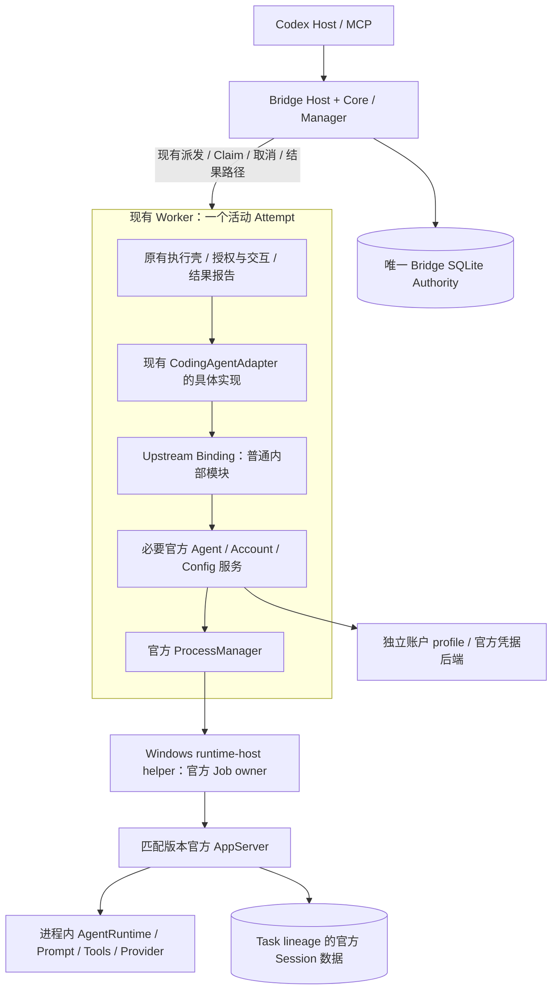

# Owner 架构收敛裁决建议

> Applicability (2026-11-11): 本文保留冻结前研究正文；已接受目标架构以 [ADR-032](../../decisions/ADR-032-existing-worker-official-host-integration.md) 为准，独立 Companion 已移出当前目标。本文账户与 Cleanup 草案仍为 Proposed，不因架构冻结成为 Accepted，也不替代现行生产合同。

> Status: RESEARCH — APPROVED_CANDIDATE 表示建议批准的候选，不代表 Owner 已正式批准或生产就绪。
> Date / Last verified: 2026-11-11，Asia/Shanghai。
> 项目根：D:/codex-zcode-bridge。当前 master 工作区，既有 WIP 保留。
> 本轮指定 Bridge 基线：`0b70edbbfb1888666d8d3b97f891a0f943fa3a9e` / tree `1976267addff37bbec61d6a94120a61f8996906b`。
> Observed 官方源码：`b95ebaffeab641907b38652f45c1502bd762972d` / tree `d7ebeb994cb8f46b16761fc9c550ae3f6e039c3d`，3.18.0。
> 本轮只读核实、设计及四份研究报告；未实施、构建、启动 Runtime 或访问真实账户。

## 1. Executive Summary

**建议正式将独立 Companion 服务进程移出当前架构，以“现有单 Attempt Worker 内装配必要官方 Host 服务 → 官方 AppServer”作为唯一首选候选。** 不增加 Companion IPC/业务 SQLite/平行 RuntimeAdapter，Upstream Binding 是 Worker 内普通模块。保留未来出现 ABI、账户共享或资源效率实证时重新立项独立服务的权利，不提前建设其框架。

本轮核实了远端已到 `372e9062`，仍按 Owner 指定固定在 `0b70edbb` 审查；其后两提交只有 AGENTS 分支工作流，已单列审查。旧→指定基线八提交没有改变 Worker/Adapter/Manager 核心实现，但补正了现行合同口径。推荐拓扑保持，不能把上一轮所有细节原样冻结。

需要明确保留四个门槛：最小官方 Host 组合未运行；新路径同账户并发未知；公开 API 未导出可持久 Job 收据；3.18.0 制品/native/许可闭包未构建验收。它们不构成提前增加 Companion 的证据，也不允许以降低并发或简化证明换取 PASS。

**本次可批准的是拓扑、职责和禁止事项；不能批准生产接入完成、同账户并发已验证、Cleanup proof 可直接复用或真实 Start Plan 可用。** 受限 POC 仅在第 9 节门槛及另行 Owner 授权后开始，本轮到报告交付即停止。

## 2. 交付与最新基线

| 文件 | 内容 |
|---|---|
| [PREVIEW_BASELINE_DELTA.md](D:/codex-zcode-bridge/docs/research/zcode-companion-owner-architecture-convergence-2026-11-11/PREVIEW_BASELINE_DELTA.md) | local/tracking/remote/master 核实、完整八提交语义、两个后续提交、关键 blob 和生命周期 |
| [SOURCE_ARTIFACT_BOUNDARY.md](D:/codex-zcode-bridge/docs/research/zcode-companion-owner-architecture-convergence-2026-11-11/SOURCE_ARTIFACT_BOUNDARY.md) | 官方模块表、副作用、Node/ABI、制品/native/BOM/许可/升级边界 |
| [ADR_PROPOSALS.md](D:/codex-zcode-bridge/docs/research/zcode-companion-owner-architecture-convergence-2026-11-11/ADR_PROPOSALS.md) | 仅两个草案：Job Cleanup/Release、账户所有权/权益来源；不修改正式 ADR |

本地 preview、origin/preview 与 `git ls-remote` 远端 preview 都是 `372e90622772b070357a278f1da3dea58fa42dee`。本轮指定 `0b70edbb` 是其祖先；后续为 `b3a3bf42` 和 PR #77 merge。master 仍是 `aabbb0a959ee234508c62731ed5122f28dfcf5b0`，是指定基线祖先。旧 `52015d12`→指定基线共八提交；master→指定基线 23 提交。

已完整阅读 [Astra 审查](D:/codex-zcode-bridge/docs/research/zcode-companion-independent-review-2026-11-11/REVIEW.md)，并结合前轮七份报告、运行摘要和固定源码调用链复核。前轮 Desktop 3.17.2 / AppServer 0.17.1 独立 Mock 实验只作历史有限运行证据，不作为 3.18.0 构建/官方 Host/真实账户验收。

## 3. Astra 建议的增量裁决

| Astra 结论 | 本轮结论 | 修订 |
|---|---|---|
| Worker 足以承载薄官方 Host，无须先加 Companion | 保持；Worker/Adapter/Manager 实现的关键 blob 未变 | 正式移出当前候选，未来实证重开须新决定 |
| 复用现有 CodingAgentAdapter | 保持接口设计 | Worker 当前硬编码具体 Adapter，outcome/checkpoint/proof 接线仍要改；不是零改动替换 |
| 官方 Host 有独立装配路径 | 源码支持，运行仍 PARTIAL | 工厂广泛副作用和内部 Repo/额外 lane 不能忽略；只装必要导出 |
| 账户 profile 独立于 Desktop | 保持 | profile 是持久身份，不是每 Attempt 克隆；不能把“POC 单活”写成产品并发限制 |
| 官方 Job 可映射到 Bridge proof | 语义方向成立 | 当前公开 lifecycle API 不暴露 Job 名称/完整收据，需窄观测口和新 proof 验证合同 |
| 现行 ADR-030 有交付前第二次 Billing | **纠正** | Preview.3 适用说明和源码为每任务一次权威 verdict，相同绑定复用。保留旧正文仅作历史，不按它增加第二次查询 |
| Node 工具链不同，需验证共同 ABI | 保持并收紧 | SQLite 实际 gate 是 >=24.16.0 <25；官方 mise 24.14.0 和 Server staging 22.16.0 均不能直接作为本产品 Worker Node |

## 4. 可冻结的最小架构



三个运行职责：Bridge 控制面、现有 Worker 执行面、官方 AppServer；Windows 另有官方原生 helper。按一个执行任务通常是三个 Node 进程加一个 helper，工具/可选浏览器可能再派生。删除的是原候选额外的 Companion 服务进程，不是官方 helper。

### 4.1 Worker 如何装配

沿现行 provenance/bootstrap/Claim 入场后，Worker 解析本次 Task/Workspace/Attempt、制品和 profile 绑定，再构造官方配置/Provider 来源、必要账户端口与 Agent Service。通过官方 commandResolver 指定匹配 Node/AppServer，Session/事件/交互由官方服务处理。缺少必要权限/验证能力时报告 unsupported，不借 Desktop Main 补齐。

`createZCodeAgentService` 的官方导出、options、Session command 和 dispose 路径提供了实现路径。`createServerHostServices`/`createLocalServices` 不作为默认入口：前者有凭据/device identity/应用迁移，后者有 CA/环境/Project/Task/Terminal 等副作用。官方 Agent Service 内部 Automation/TaskIndex Repo 和 plugin/mcp-status manager 对象保留，不复制官方实现；初期不调用会启动额外控制面进程的操作。最小必要调用是否触发辅助存储，仍需实际验证。

需要的模块和副作用逐项表在制品报告第 3 节。REQUIRED 不等于已运行；MOCKABLE 也不意味着自动禁止其底层真实文件访问，POC 要分别隔离路径和端口。

### 4.2 Adapter / Binding 边界

沿用 startTask/continueTask/getStatus/getResult/cancelTask。具体 Adapter 把 TaskPackage/Workspace/continuation 转为 binding 操作，binding 输出 Bridge 自有事件/outcome和受控资源事实。官方 Session、V4 command/envelope、provider/account类型、RPC method/schema 全留在绑定模块及执行制品。

Core 不导入官方 private 包，不分析上游帧，不透传任意 method。官方升级时优先调整 binding/composition/制品；影响授权/Outcome/Cleanup/发布依赖则仍需 Bridge 合同变更，不能承诺“永远只改一个 Adapter 文件”。固定 commit、配套 Host/AppServer、接口 manifest 和实际制品回归保证匹配，无须新服务版本协商框架。

### 4.3 进程/资源唯一正常所有权

| 进程/资源 | 正常所有者 | 异常与释放责任 |
|---|---|---|
| Bridge Host/Core | Bridge 入口 | 关闭自己的端口/数据库；Host close 不伪称任务 Cleanup |
| Worker | Bridge Worker Manager / SQLite Claim | 现有精确身份、取消、Recovery、Hold 和 Release；不按进程名/PID 批量终止 |
| AppServer | 官方 ProcessManager | 正常 stop/dispose/owned-process 收束；fatal 后 binding 禁止原输入自动重发 |
| Windows runtime-host helper / Job | 官方实现 | helper 与真实 Runtime PID 分开；原子归组与 Job empty 机制复用 |
| Browser | 实际创建它的官方服务或 Bridge BrowserHost | 明确 Job 内/外、profile/进程归属；独立关闭证据，未验证则保留占用 |
| 工具后代 | 创建它的执行链/所属官方 Job | Job 成员由官方正常清理；越出 Job 或 Host 自建资源须另证 |
| 官方辅助 Repo/监听器/Host native 资源 | Worker 内选定官方服务 | 有界 dispose及必要资源核验，不能仅关闭 AppServer |

Bridge 不与官方 ProcessManager 同时常规重启/杀同一个 AppServer。Bridge 的异常 fallback 是有身份、有范围、由明确取消/恢复触发的兜底，不能变成第二个常驻 supervisor。

## 5. 数据与账户所有权

Bridge SQLite 仍唯一拥有 Task/Attempt/Claim/Result/Cleanup/Release。官方 Session/event/checkpoint 存 Task lineage 持久根；同任务后续 Attempt 在前次 Release 后顺序复用。Attempt 临时/log根独立；官方必要辅助数据库不算 Companion 业务库，但不能复制 Bridge 任务状态或成为第二权威。

账户推荐：**持久、显式供给、独立于 Desktop 的逻辑 profile，Worker 内官方账户服务按该 profile 工作。** 不要求每任务新登录，不复制 token 造独立 profile。不同任务的 Session/工作区数据分开；同 profile 的凭据文件锁/CAS、snapshot/revision 和网络签发必须分别验证。

源码已确认文件更新有跨进程锁，OAuth snapshot 有条件提交，新 revision 可写入持久层；但账号投影通知、项目 token 单飞/cache 主要是进程内。公开具体 OAuth adapter 没有现成 refreshToken 实现，不能把泛型刷新入口当成已可用的透明续期方案；也不能把账号 profile refresh、Project Token 换证和 OAuth token rotation 混称“刷新已支持”。

当前最简单方案不需要 Broker。额外账户级锁仅在可证明必要的修改/换证短事务使用，**不锁整个 Worker 或整个模型流**。同账号多个独立 profile 是否被远端允许、共享 profile 的并发换证/失效传播是否可靠仍未知。现有 Worker slots/路径调度不变；新路径是否完整保留同账户并发不能给 PASS。

若需要共享账户 owner，先证明官方机制不能满足；放在现有 Manager 中也不能自动解决，因为多个 Manager 的进程内锁互不约束，且 detached Worker 不应因 Manager 重启失去唯一 auth owner。只有明确需要时才考虑单独账户职责的窄 owner，不让它管理 Session/AppServer/Task。

ADR-030 修订后的单次任务权威 verdict、fail-closed、绑定、Private Lease/HANDLE/ACK、非跨任务缓存继续有效。新官方权益事实源的时效、unknown、失败、身份变更和 last-known-good 语义须先验证并批准替代条款；本轮不删 Billing、不换认证链。详见账户 ADR 草案。

## 6. Cleanup Proof 与并发的冻结边界

**可冻结：**Outcome、Runtime 关闭、Job empty、Worker 关闭、Cleanup 和 Release 分离；官方正常管理所属进程，Manager最终审核释放；缺证保留 Hold；同一输入不自动重发。

**不可宣称已经完成：**官方 dispose 返回值就是旧 Cleanup Receipt。官方公开 WindowsRuntimeHost.close 返回 void，Job 名称和 empty 观测留在内部；ProcessManager lifecycle reporter 不包含完整 Job identity/closure 收据。必须有非秘密可恢复的观测端口、新 proof 类型、Manager 验证器与 Recovery 适配。不能解析日志、猴子补丁、伪造旧 receipt 或只查根 PID。

初始模型是每 Worker 一个执行 AppServer，一个无关任务 lineage；官方子 Session 将来只能属于该任务。插件管理/MCP status专用lane初期不调用，不把“创建多个 manager对象”误判为必须起多个引擎。Shared AppServer/池化不进入当前冻结范围。

产品并发是不可静默降低的要求。POC 第一阶段可单实例定位构建和关闭问题，但后续必须验证两 Worker、同 profile、独立任务根和取消/崩溃互不串用。只有独立 profile 成功不能满足同账户门槛；未验证时保留 UNKNOWN，而不是给产品增加每账户单 Worker 限制。

## 7. Owner 决策表与复杂度变化

| 决策项 | 建议 | 明确范围 |
|---|---|---|
| Companion 独立进程 | **REMOVE** | 从当前首选拓扑移除；未来有实证可重新提案，不保留空服务框架 |
| 现有 Worker | **MODIFY** | 保留生命周期/Claim/执行壳，修改具体 Adapter与绑定接线，不另造 Worker Manager |
| CodingAgentAdapter | **KEEP** | 复用接口；具体执行实现内部对接官方服务 |
| Upstream Binding | **KEEP** | 普通 Worker 内模块，不单独 package |
| 新增 Companion IPC | **REMOVE** | 原 Bridge–Worker 私有管道、官方 RPC/原生控制管道继续存在 |
| Companion SQLite | **REMOVE** | 无自有业务库；保留官方必要 Session/辅助存储 |
| 官方 Agent Service | **KEEP 必要组合** | 复用会话/事件/反向交互，避开完整应用装配 |
| 官方 ProcessManager | **KEEP** | 独占 AppServer正常生命周期，内部惰性 lane 不重写 |
| AppServer 数量 | **每 Worker 一个执行实例** | 不共享无关任务，不建池 |
| 账户所有权 | **独立持久 profile + Worker 内官方服务** | 同 profile 多消费者为目标，refresh/失效需证；Broker DEFER |
| Worker 并发 | **保留现有调度合同** | 新路径端到端能力 UNKNOWN；不批准整任务账户锁 |
| Cleanup Proof | **typed Job/资源映射，PARTIAL** | 观测口、可恢复归属和新验证器是生产门槛 |
| 固定官方制品 | **版本固定，配套分发** | 实际构建/native/BOM仍待验；不用 Desktop 安装元数据 |

相对原 Worker→Companion 候选，每活动任务减少一个额外 Host/Companion 服务进程、其 spawn/ready/shutdown/failure恢复逻辑、一组自建 IPC codec/版本配对/连接故障场景；删除新业务库/第二 Task状态镜像的需求；省去平行 RuntimeAdapter 和独立 binding package 的维护。**这些是删除候选设计需求，当前生产代码本轮删除行数为零。** 不给未经实现的 LOC/RSS/吞吐百分比。

仍需完成的工作并未消失：官方最小服务接线、账号供给及并发、交互/事件/Outcome映射、Job与额外资源证明、固定制品native闭包、许可与升级/回滚。这些是真实集成工作，增加或减少一个进程都不能代替。

## 8. 对十个架构问题的直接回答

| 问题 | 回答 |
|---|---|
| 1 Core 是否无需知道 ZCode RPC？ | **是，作为冻结边界。** 当前协议位于具体 Adapter；未来在 binding/官方服务内，Core 不解析它。 |
| 2 Worker 能否直接装配官方 Agent Service？ | **源码支持这一路径，运行未验证。** 有真实导出/参数和官方无头组合参考，最小闭包 PARTIAL。 |
| 3 是否可以不依赖 Desktop Main？ | **设计可行。** 官方无头凭据后端存在；不要导入 Desktop默认Main回调；完整账号运行未验。 |
| 4 能否不增加 Companion？ | **是，当前唯一首选。** 尚无具体 ABI/账户/性能证据强制新增。 |
| 5 能否保持既有 Worker 并发？ | **设计要求保持，实际新路径 UNKNOWN。** 不降低 slots，不加 task-long account lock；同 profile 多进程需验证。 |
| 6 能否复用官方 ProcessManager？ | **是。** 不重写正常生命周期；可恢复 Job事实导出和 Bridge proof仍需接线。 |
| 7 上游更新影响什么？ | binding/composition/Host+AppServer制品/native/资源/回归；若授权/Proof语义变化则涉及Bridge合同。 |
| 8 是否需要 ZCode Fork？ | **不作为设计要求。** 固定只读源码+外部小装配入口；若需大量核心补丁，停止并重新审查。 |
| 9 是否需要独立 Node？ | **没有必须新增服务的证据。** 首试共同24.16.0；可只给AppServer独立Node，不必加Companion。完整Host/native兼容未验。 |
| 10 生产不可绕过的门槛？ | 最小Host实际制品、账号供给/权益/同账户并发、Job资源/Recovery proof、Node/native/BOM与回滚、现有Bridge合同回归。 |

## 9. POC 门槛、范围与停止标准

POC_ENTRY 为 **READY_WITH_GATES**：方向和下一步问题已明确，不表示已经获准执行。本轮不启动任何 POC。

进入前必须：

1. Owner 批准本候选的 ACCEPT 项与实验范围；明确两个 ADR 草案仍有待验证条款，不自动改正式合同。
2. 冻结一个可审查的最小服务组合、路径解析和全部初始化副作用清单；所有真实账户/设备初始化由 Mock 端口与隔离根阻止，不调用完整 Host 工厂碰运气。
3. 冻结共同 Node24.16.0 候选、构建工具版本、native/resource/BOM配方；批准后才可构建，不预先下载。
4. 确定如何获得 Job事实的最小研究观测入口。若现有导出不足，POC 可先停在 Runtime关闭事实，但不能把 Bridge Cleanup/Release记为通过；不得为“全链绿灯”改安全验证或官方核心。

最小 POC分两步：先在研究 Worker中构建/加载真正3.18.0官方Host+匹配AppServer+helper，使用loopback Mock Provider，验证create/submit/stream/Read工具二次请求/取消/resume/正常关闭；再做两个Worker的独立任务并发与账户服务多进程Mock，覆盖相同profile的修改竞争、旧revision/rotation拒绝、Manager/Worker/helper崩溃与不串用。第二步不能用第一步的单活实验限制代替产品并发验收。

成功须以实际制品证明：一次输入不重复、身份/事件关联、取消和迟到拒绝、路径独立、完整资源归属、正确unknown和Hold，以及可验证的Job/Worker关闭。构建/运行失败、默认触碰真实Desktop/账户、必须复制官方核心、只能根PID证明、自动重发或静默串行同账户任务，都要保留失败并停止对应门槛。

不提前实现：常驻Companion、Credential Broker、HTTP/命名管道服务框架、共享AppServer池、通用恢复平台、生产认证切换、SQLite迁移、全插件/Memory/Subagent/Browser/CUA、自动升级/发布或真实账户模型验收。真正账户行为需要后续另行明确授权，Mock不能给真实套餐PASS。

## 10. Owner 可直接裁决的四组结论

**ACCEPT — 建议批准并冻结：**唯一首选为现有Worker内必要官方Host；沿用CodingAgentAdapter，内部binding；官方AppServer执行AgentRuntime；官方ProcessManager正常独占所属Runtime；Bridge权威和原有并发合同保留；独立固定制品、数据根及profile；无新Companion进程/IPC/业务库/RuntimeAdapter。

**DEFER — 等待POC证据：**最小Host闭包和副作用、共同Node/native、同profile并发/刷新/失效、Job观测口与新proof/Recovery、真实Provider功能与权益时效、精确BOM/回滚；ABI冲突、账号共享或资源效率有实证时重新引入窄服务的权利。

**REJECT — 当前不再推荐：**预先建设独立Companion、完整OfficialHost一把启动、双TaskAuthority、独立binding package、通用RPC框架、task-long账户锁、复制Desktop凭据/身份、unknown权益当true、dispose成功包装旧receipt、Outcome即Release、自动重发或自动回退认证链。

**BLOCKERS — 生产接入前必解：**上述账户并发/供给及官方真实权益替代、持久资源证据和Manager验证、构建制品/ABI/许可闭包、Session数据兼容与现有Bridge回归。真实Start功能若受公开版本缺口阻断，应单独保持BLOCKED，不伪造安装版能力。

A：建议正式放弃当前独立Companion拓扑。B：建议唯一首选定为现有Worker+官方Host。C：保留基于实证重开服务边界的权利。D：减少的进程/协议/状态与恢复维护见第7节。E：账号、证明和制品门槛不能省。F：先验证真正官方Host组合和失败事实，再验证多Worker；不建设其它平台能力。

## 11. 验收状态与执行边界

```text
PREVIEW_BASELINE_VERIFIED: PASS
PREVIEW_DELTA_REVIEW: PASS

WORKER_HOST_ASSEMBLY_DESIGN: PARTIAL
CODING_AGENT_ADAPTER_REUSE: PASS
UPSTREAM_BINDING_BOUNDARY: PASS

COMPANION_PROCESS_NECESSITY: REMOVE
ADDITIONAL_IPC_NECESSITY: REMOVE
ADDITIONAL_DATABASE_NECESSITY: REMOVE

ACCOUNT_OWNERSHIP_DESIGN: PARTIAL
ACCOUNT_CONCURRENT_REFRESH: UNVERIFIED
EXISTING_WORKER_CONCURRENCY: UNKNOWN

CLEANUP_PROOF_MAPPING: PARTIAL
OFFICIAL_SOURCE_ARTIFACT_BOUNDARY: PARTIAL
REDISTRIBUTION_REVIEW: PARTIAL

FINAL_ARCHITECTURE: APPROVED_CANDIDATE
POC_ENTRY: READY_WITH_GATES

PRODUCTION_CODE_MODIFIED: NO
OFFICIAL_SOURCE_MODIFIED: NO
SQLITE_MODIFIED: NO
REAL_ACCOUNT_REQUESTS: 0
REAL_MODEL_REQUESTS: 0
STARTPLAN_REQUESTS: 0
BILLING_REQUESTS: 0
POC_IMPLEMENTED: NO
COMMIT_CREATED: NO
PUSHED: NO
MERGED: NO
RELEASED: NO
```

PASS仅指基线/语义审查或接口职责设计完成。PARTIAL保留了明确缺口；UNKNOWN指新执行路径的同账户并发，当前生产并发代码没有改变。APPROVED_CANDIDATE不代表批准真实账户或生产切换；需要Owner裁决后才进入后续工作。

四个文件写入前已确认目标目录不存在；仅新增本目录。原有三个已修改文件及四个未跟踪文件（含上一轮报告）内容保持；未移动任何工作区或ref。结束前再次检查Git状态、原WIP SHA256和报告链接/格式。

本轮只运行只读Git/源码/报告检查及文档自检。生产test:affected/T0、build、typecheck、完整测试、官方构建与所有Runtime实验均NOT_RUN：用户限定只读核实与编写研究报告，禁止实施/构建/启动，未运行会重建提交物的流水线。`STRESS_TESTS_NOT_APPLICABLE`。文档自检不当成产品测试PASS。

交付后停止，等待Owner批准最终架构合同与后续POC授权。
